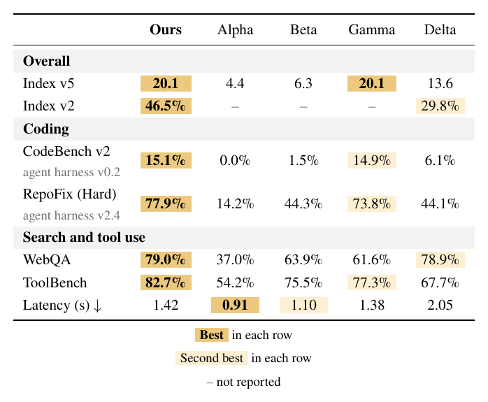
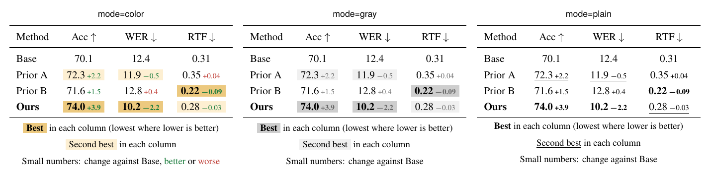
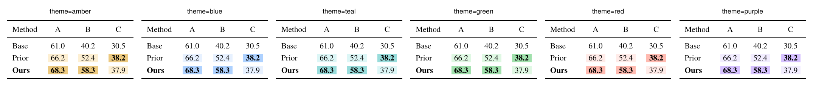
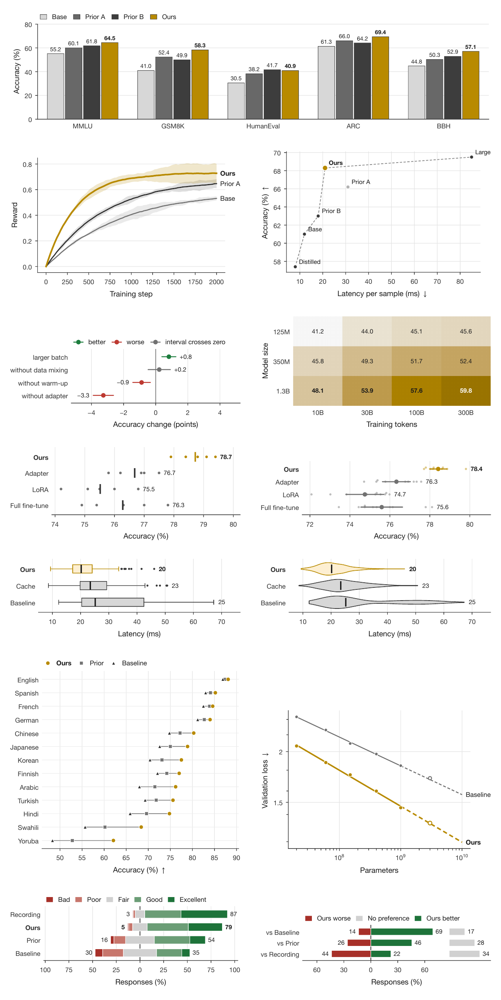
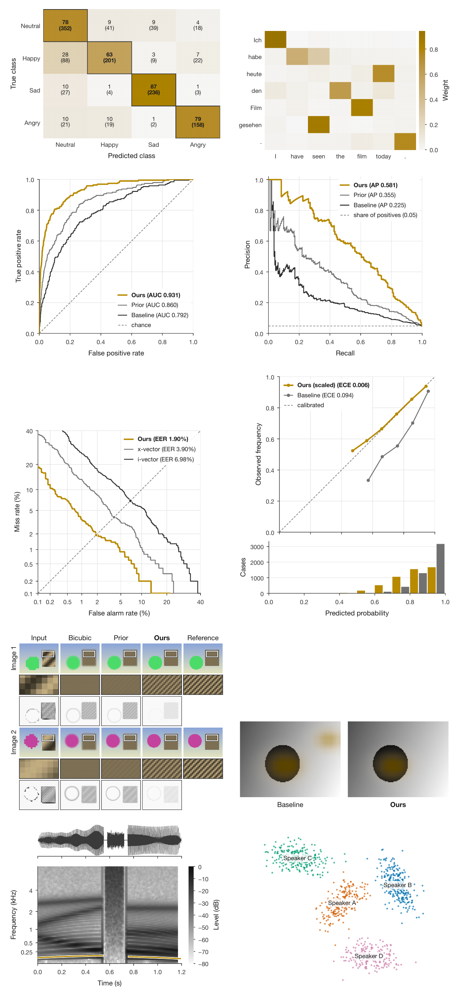
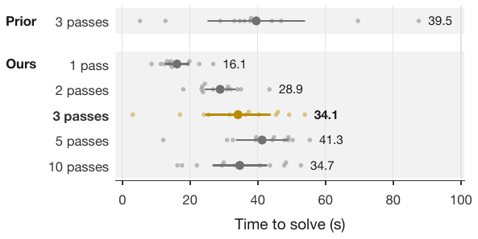
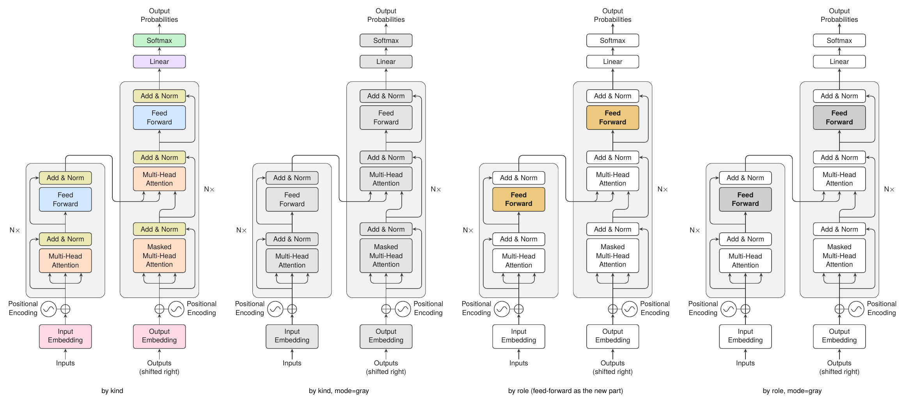
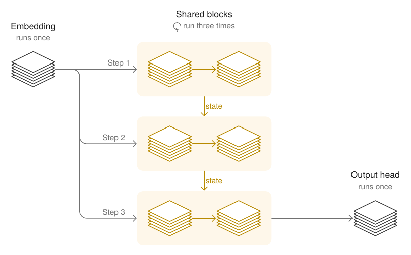
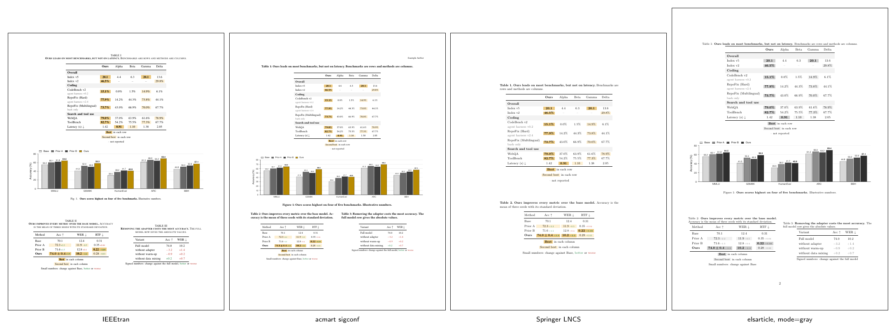

# pubviz

**pubviz**: one look for the tables, figures and diagrams of every paper you
write, inside whichever venue's template it goes to.

Venue templates decide the page: margins, columns, fonts. They say little
about how a result should be shown, so every paper invents its own way to
point out the best number or to set the proposed method apart. This
repository settles that part once. A [decision tree](docs/decision-tree.md)
picks the exhibit a result needs, a short [guide](docs/guide.md) says what
each kind of table, figure and diagram is for, and pubviz carries it out: a
LaTeX package for tables and diagrams, and a Python library for figures. All
of them take their colors from one accent color and keep their meaning on a
black-and-white page.



The table above was written as an ordinary table body. pubviz found the
numbers and marked the best and second-best value in each row; the two tied
values share first place. It read the `↓` on the latency row, so the lowest
latency is marked there. It also greyed the missing values, drew the section
bands, and wrote the key underneath from what the table shows.

- [How the parts fit together](#how-the-parts-fit-together)
- [Install](#install)
- [Quick start](#quick-start)
- [Tables](#tables)
- [Figures](#figures)
- [Diagrams](#diagrams)
- [Venues](#venues)
- [Options](#options)
- [Limits](#limits)
- [Development](#development)

## How the parts fit together

1. **One accent color.** You pick it, or keep the default amber. Every other
   color is made from it at fixed lightness levels: the fills that mark the
   best values, the shading of a grid, the color of your method in a plot.
   Because the levels are fixed, their order survives grey printing.
2. **Tables and diagrams are drawn inside the paper** by `pubviz.sty`, so
   they work on Overleaf with nothing else installed.
3. **Each compile writes a layout file,** `<jobname>.pubviz.json`, next to
   the PDF. It records the column width, the text width, the body font size,
   the fonts and the colors of that document.
4. **Figures read the layout file.** The Python library draws each figure at
   its printed width, with text sized for that venue, in the same colors as
   the tables.

For venues that print in black and white, `mode=gray` turns every color into
the grey of the same lightness, and `mode=plain` drops the fills for bold and
underline.

## Install

**LaTeX.** Copy [`latex/pubviz.sty`](latex/pubviz.sty) next to your paper
(on Overleaf, upload it to the project) and load it after the venue's own
packages. It loads xcolor, colortbl, booktabs and array itself.

```latex
\usepackage{pubviz}              % tables and colors
% or
\usepackage[diagrams]{pubviz}    % the same, plus the diagram styles (loads TikZ)
```

It needs a LaTeX kernel from November 2023 or later.

**Python** (3.10 or newer).

```sh
pip install pubviz            # or: uv add pubviz
pip install "pubviz[pandas]"  # to pass pandas DataFrames
```

The library needs matplotlib 3.10 and NumPy 2.0 or newer. Tested with TeX
Live 2026 (pdfLaTeX, LuaLaTeX and XeLaTeX) and with Python 3.10 to 3.14.

**Coding agents.** A skill teaches an agent (Claude Code, Codex and others
that read skills) to use pubviz: setting it up, choosing the exhibit a
result needs, and checking each one before handing it over.

```sh
npx skills add JacobLinCool/pubviz
```

## Quick start

1. Load pubviz in your paper and put a results table in `pvtable`, as in
   [Tables](#tables).
2. Compile. Next to the PDF you now have `<jobname>.pubviz.json`.
3. Draw a figure from that file and save it into the paper's figure folder,
   as in [Figures](#figures).
4. Include it with `\includegraphics[width=\linewidth]{...}` and compile
   again.

When you cannot get the layout file yet, draw from a venue preset and give
the paper's accent: `pv.use("neurips", theme="blue")`. The presets are listed
under [Venues](#venues).

## Tables

Write the table body as usual inside `pvtable`, and put `\pvkey` after it:

```latex
\begin{table}[t]
  \centering\small
  \caption{\textbf{Ours improves every metric over the base model.} ...}
  \begin{pvtable}[delta=absolute]{lccc}
    \toprule
    Method & Acc \pvup & WER \pvdown & RTF \pvdown \\
    \midrule
    \pvbaseline Base & 70.1 & 12.4 & 0.31 \\
    Prior A & 72.3 & 11.9 & 0.35 \\
    \pvours Ours & $74.0 \pm 0.4$ & 10.2 & 0.28 \\
    \bottomrule
  \end{pvtable}
  \pvkey[baseline=Base]   % the key; baseline= is how it names the reference
\end{table}
```

### What pubviz reads from the body

- **Numbers.** A cell that holds a number (optionally signed, with `\%`, or
  as `$mean \pm spread$`) takes part. Anything else is left as written. Wrap a
  number in braces, `{2024}`, to keep it out.
- **Headers.** Rows above the first `\midrule` are headers and never ranked.
- **What is compared.** With `by=column` (the default) the values in each
  column are compared, for methods listed down the table. With `by=row` each
  row is compared, for methods listed across.
- **Direction.** An arrow where a measure is named (`\pvup`, `\pvdown`,
  `$\uparrow$`, `$\downarrow$`) sets which way is better; otherwise `better=`
  decides.
- **Methods.** `\pvours` (set in bold), `\pvbaseline` (the reference for
  changes) and `\pvnorank` (shown but never ranked, such as an oracle) go
  where a method is named: in the label column with `by=column`, in the header
  with `by=row`.
- **Missing values.** `-`, `--`, `n/a` or `\pvna` become a grey dash.
- **Sections.** `\pvsection{Coding} \\` is a full-width band.
- **Sub-labels.** `\pvlabel{RepoFix}{harness v2.4}` puts a small grey line
  under a label.

### The key under a table

`\pvkey` puts a key under the table. Each line starts with the mark it
explains, such as "Best" in the best fill or "better" in the color of a
change that helps, so the caption does not have to describe colors. The key
lists only what the table shows. The note on ties appears only when a tie
happens, and in `plain` mode the key shows bold and underline instead of
fills.

Change the words for one key, `\pvkey[best={Best reported score}]`, or for
the whole paper, `\pvsetup{key/best={Best reported score}}`.

### The key in other languages

The key is in English unless the paper says otherwise.
`\usepackage[language=zh-tw]{pubviz}` writes every word of it in
Traditional Chinese (最佳、次佳、每欄…); `zh-cn`, `ja` and `ko` are built in
as well. Any other language is a set of words:

```latex
\pvdefinelanguage{de}{best=Beste, second=Zweitbeste, each-column=in jeder Spalte,
  small-numbers=Kleine Zahlen, against=Änderung gegenüber, baseline=der Basis,
  better=besser, worse=schlechter, or=oder}
\pvsetup{language=de}
```

A set may leave words out; those stay English. Every word is also a `key/`
option (`key/each-column`, `key/ties`, `key/small-numbers`…), as is the
punctuation (`key/open`, `key/close`, `key/semicolon`, `key/colon`,
`key/comma`) and `key/spaced`, which says whether words are separated by
spaces (English, Korean) or not (Chinese, Japanese). The definitions of the
built-in languages at the end of the options in `pubviz.sty` list every
key. Options set after `language` change one word.

The layout file carries the language and the words a figure writes itself,
such as the key of `pv.deltas`, so figures follow the paper in any language
it defines. Chinese, Japanese and Korean characters in a figure fall back to
the first installed font for that language (PingFang, Hiragino, Apple SD
Gothic Neo, Microsoft JhengHei or YaHei, Malgun Gothic, Noto Sans CJK…), then
to those of the other three. Linux often has none of them; install one, such
as the `fonts-noto-cjk` package, or matplotlib draws empty boxes. Compile a
CJK paper with XeLaTeX and `xeCJK` or LuaLaTeX and `luatexja`.

The row marked `\pvours` gets a line only when you name it, for example
`\pvkey[ours={Our method}]`: the words are set in the same style as the
row's name (bold by default), so the line shows the mark it explains, as the
other lines do. A row already called "Ours" explains itself, so there is no
line by default.

### Marks by hand

The same marks work by hand in any `tabular`: `\pvbest{..}`,
`\pvsecond{..}`, `\pvthird{..}`, `\pvheat{0.7}{..}`, `\pvdelta{+2.3}`,
`\pvdelta[lower]{+0.4}`, `\pvna` and `\pvsectionrow{<columns>}{<title>}`. To
explain a mark in a caption that sits above its table, write
`\pvbest{Best} in each row`.

### Tables from Python

For results that live in Python, `pv.pvtable` returns the LaTeX of a
`pvtable` from a dict (row → {column: value}) or a DataFrame:

```python
import pubviz as pv

print(pv.pvtable({"Base": {"Acc": 70.1, "WER": 12.4}, "Ours": {"Acc": 74.0, "WER": 10.2}},
                 ours="Ours", baseline="Base", lower=["WER"], key=True))
```

### Colors and print modes

```latex
\usepackage[theme=blue]{pubviz}   % amber, blue, teal, green, red, purple, gray
\pvsetup{accent=1A73D5}             % or any hex value or xcolor color
\pvsetup{mode=gray}                 % color | gray | plain
```





Every option is listed under [Options](#options).

## Figures

Point the library at your paper's layout file, draw, save, and include the
figure at the width it was built for:

```python
import pubviz as pv

scores = {"Base": {"MMLU": 55.2, "GSM8K": 41.0}, "Ours": {"MMLU": 64.5, "GSM8K": 58.3}}

pv.use("paper/main.pubviz.json")   # or a preset from Venues, such as "neurips"
fig, ax = pv.figure("column")        # "column", "text", a fraction of the text width, or inches
pv.bars(ax, scores, ours="Ours", ylabel="Accuracy (%)")
pv.save(fig, "paper/figs/scores")    # writes paper/figs/scores.pdf with its fonts embedded
```

```latex
\includegraphics[width=\linewidth]{figs/scores}
```

`pv.save` prints a warning for a width changed after `pv.figure` (or, for a
figure made another way, a width that is neither the column nor the text
width), for an axes title (put the title in the LaTeX caption), for text
smaller than 5 pt, and for texts that overlap or run off the figure. The
figure functions widen their axes so the values they print stay inside, and
set a key in as many columns as the width allows.

Results of experiments:

| Function | Shows | Example |
| --- | --- | --- |
| `bars` | which method scores higher, benchmark by benchmark | [`bars.py`](examples/figures/bars.py) |
| `deltas` | how much each change helps or hurts, with the interval of the change | [`deltas.py`](examples/figures/deltas.py) |
| `curves` | how a measure moves over steps, time or scale, with the spread over seeds | [`curves.py`](examples/figures/curves.py) |
| `tradeoff` | what each method gains on one measure and pays on another, with the frontier | [`tradeoff.py`](examples/figures/tradeoff.py) |
| `heatmap` | values over two factors | [`heatmap.py`](examples/figures/heatmap.py) |
| `dots` | every run of each method, for a handful of runs, with the mean | [`dots.py`](examples/figures/dots.py) |
| `means` | the level of each method with the uncertainty of its mean, as an interval or a gradient, over the runs themselves | [`means.py`](examples/figures/means.py) |
| `distributions` | how many runs spread: box plots, strips, violins or histograms, chosen by what the reader judges | [`distributions.py`](examples/figures/distributions.py) |
| `ranked` | one value per item for many items (languages, classes), a dot per system, sorted; in place of a radar chart | [`ranked.py`](examples/figures/ranked.py) |
| `scaling` | a measure against size, data or compute on log axes, with fitted power laws and the points held out of the fit | [`scaling.py`](examples/figures/scaling.py) |
| `ratings` | how people rated each system on an ordered scale, or win / tie / loss, as diverging stacked bars | [`ratings.py`](examples/figures/ratings.py) |



What a model does:

| Function | Shows | Example |
| --- | --- | --- |
| `confusion` | which classes are mixed up, as shares of each true class, with counts | [`confusion.py`](examples/figures/confusion.py) |
| `attention` | weights between the items of two sequences (attention, alignment) | [`attention.py`](examples/figures/attention.py) |
| `roc`, `precision_recall`, `det` | a classifier or detector over every threshold, with its reference line and summary | [`roc.py`](examples/figures/roc.py), [`precision_recall.py`](examples/figures/precision_recall.py), [`det.py`](examples/figures/det.py) |
| `reliability` | whether predicted probabilities match how often they come true, with the cases per bin | [`reliability.py`](examples/figures/reliability.py) |
| `images` | the same examples as each method gives them, with one region enlarged | [`images.py`](examples/figures/images.py) |
| `overlay` | a saliency or attention map over an image | [`overlay.py`](examples/figures/overlay.py) |
| `spectrogram`, `waveform` | a sound over time, in dB, with its pitch contour | [`spectrogram.py`](examples/figures/spectrogram.py) |
| `embedding` | a t-SNE, UMAP or PCA map of points, each class named on the map | [`embedding.py`](examples/figures/embedding.py) |



In LaTeX, `\pvshade{t}{word}` shades a word by its weight (`\pvshade*` for
signed weights), and `pv.pvshade(tokens, weights)` writes a whole sentence of
them, so attributions over text stay text in the paper's font.

Each example runs on its own: the data at the top, then the drawing, and in
its docstring the LaTeX that includes the figure with a caption. The
[guide](docs/guide.md#figures) shows every kind with its image and says when
to use it.

Other helpers:

- `pv.use(..., font="body")` sets figure text in the paper's body face
  instead of sans.
- `pv.use(..., language="ja")` writes the figures' own words in a built-in
  language when there is no layout file to take it from; for another
  language pass its words, `words={"better": ..., "worse": ..., "crosses": ...}`;
  the same dictionary can replace the axis titles some kinds write by default,
  such as `"true"` and `"predicted"` for `confusion` (see `pv.style.LABELS`).
- matplotlib sets a label that contains `$...$` entirely in its math fonts,
  which have no CJK characters. In a Chinese, Japanese or Korean label, write
  `L`, not `$L$`; `pv.tradeoff` already writes its arrow as a plain
  character in such labels.
- `sections={"Prior": [...], "Ours": [...]}` groups the rows of `deltas`,
  `dots`, `means`, `distributions`, `ranked` and `ratings`, or the benchmarks
  of `bars`, into a second level, as `\pvsection` does in a table: a gap
  before each section, its name beside or under its members, and a light
  band behind each section (`band="alternate"` shades every other one,
  `band=None` none).
  Naming rows as (section, member) pairs, such as `("Ours", "3 passes")`,
  gives the same without `sections=` and lets a member name repeat across
  sections.



- `pv.panel_labels(axes)` labels the panels of a figure (a), (b), ….
- `pv.mean_ci(runs)` gives the mean and the 95% interval over seeds.
- On the command line, `pubviz roles amber` prints every color made from an
  accent with its grey, and `pubviz layout paper/main.pubviz.json` prints
  the sizes a layout file sets.

## Diagrams

`\usepackage[diagrams]{pubviz}` adds TikZ styles for method and
architecture diagrams, in the colors and print modes of the tables, and a
`pvdiagram` environment. It draws the diagram at its printed size and warns
when it is wider than the line it sits in (the column, or the text width in
a `figure*`), instead of letting it be scaled down.

By default blocks are filled by role: all white, and only the part your
paper adds in the accent, so the reader finds your change at a glance. With
`pv kinds` in the `pvdiagram` options they are filled by kind instead: each
kind of layer gets its own light fill, and the part your paper adds gets a
thick accent border. The
[guide](docs/guide.md#diagrams) says when each fits.



The diagram above is [`examples/diagrams/transformer.tex`](examples/diagrams/transformer.tex),
redrawn from Vaswani et al. (2017). It fits a single column of the IEEE and
ACM example papers and a column as narrow as ICML's (3.25 in).

```latex
\begin{pvdiagram}
  \node[pv block] (attn) {Attention};
  \node[pv block, pv new, above=of attn] (ffn) {Gated FFN};
  \draw[pv flow] (attn) -- (ffn);
\end{pvdiagram}
```

| Style | Draws |
| --- | --- |
| `pv block` | a layer or a step: a rounded white box |
| `pv new` | the part your paper adds: accent fill, or a thick accent border with `pv kinds`; bold label |
| `pv kinds`, `pv kind=1`…`6` | one light fill per kind of layer (orange, blue, yellow, pink, purple, green) |
| `pv group` | a box around blocks that belong together, such as a repeated layer |
| `pv op`, `pv wave` | an add (⊕); a positional encoding (∿) |
| `pv flow`, `pv line` | an arrow; a line; both with rounded corners |
| `pv label`, `pv note` | text outside blocks; small grey text on an edge, such as a tensor shape |

A lighter style draws stages and flows with fewer lines: a stack of layers
as a small picture, thin grey links with open arrowheads, a title with a grey
note above each stage, and a light region behind the parts that belong
together. Three examples use it:
[`looped.tex`](examples/diagrams/looped.tex) (blocks that run several times),
[`asr.tex`](examples/diagrams/asr.tex) (a pipeline from speech to text) and
[`retrieval.tex`](examples/diagrams/retrieval.tex) (retrieval before
generation).



| Style | Draws |
| --- | --- |
| `pv stack`, `pv layers=n` | a stack of n layers as a small picture; a node, so `right=of` and `.east` work |
| `pv link` | a thin grey arrow with an open head and rounded corners, for a flow or a branching line |
| `pv region`, `pv region=pv-fill-3` | a light region with no border behind parts that belong together; tinted with the accent for the part your paper adds |
| `pv title`, `\pvnote{...}` | a stage title, and a small grey line under it |
| `pv emph` | an edge, a label or a stack in the accent; near black with a heavier line in grey and plain print |
| `\pvrepeat` | a loop sign, for a part that runs more than once |

## Venues

The same example paper, unchanged, in the IEEE, ACM, LNCS and Elsevier
templates. Its figures were drawn from each document's own layout file.



Presets for drawing figures before the paper compiles (widths in inches):

| Preset | Column | Text | Body | Source |
| --- | --- | --- | --- | --- |
| `neurips` | 5.50 | 5.50 | 10 pt | `neurips_2025.sty` |
| `iclr` | 5.50 | 5.50 | 10 pt | `iclr2026_conference.sty` |
| `icml` | 3.25 | 6.75 | 10 pt | `icml2025.sty` |
| `cvpr` | 3.28 | 6.88 | 10 pt | `cvpr.sty` (author kit) |
| `acl` | 3.03 | 6.30 | 11 pt | `acl.sty` |
| `ieee` | 3.49 | 7.14 | 10 pt | `IEEEtran` (compiled) |
| `acm` | 3.34 | 7.01 | 9 pt | `acmart` sigconf (compiled) |
| `acm-small` | 5.48 | 5.48 | 10 pt | `acmart` acmsmall (compiled) |
| `lncs` | 4.80 | 4.80 | 10 pt | `llncs` (compiled) |
| `elsevier` | 3.49 | 7.22 | 10 pt | `elsarticle` 5p (compiled) |
| `article` | 4.77 | 4.77 | 10 pt | `article` (compiled) |

"Compiled" values were measured by compiling the class from TeX Live 2026;
the others were read from the venue's style file. Templates change from year
to year, so once the paper compiles, use its layout file.

acmart 2.16 drops floats that are still waiting at `\end{document}`, with or
without pubviz, so end an acmart paper with `\clearpage`.

## Options

Set an option for the whole paper with `\pvsetup{...}` or as a package
option, or for one table with `\begin{pvtable}[...]`. Two are read only once:
`diagrams` as a package option, and `layout-file` in the preamble.

**What a table compares**

| Option | Values (default first) | Effect |
| --- | --- | --- |
| `by` | `column`, `row` | compare within each column, or within each row |
| `better` | `higher`, `lower` | direction for measures without an arrow |
| `ranks` | `2` (0 to 3) | how many places get a mark |
| `ties` | `shared`, `dense` | after a tie for best, the next value is third (`shared`) or second (`dense`) |
| `delta` | `none`, `absolute`, `relative` | show the change against the `\pvbaseline` method |
| `show` | `both`, `delta` | show value and change, or the change alone |
| `delta-digits` | `1` | decimals of a relative change (absolute changes keep the decimals as typed) |
| `heat` | `none`, `group`, `table` | shade by value within each column or row, or across the table |
| `header` | `auto`, a number | how many leading rows are headers |
| `label-cols` | `1` | how many leading columns are labels |

**How marks look**

| Option | Values (default first) | Effect |
| --- | --- | --- |
| `fill` | `chip`, `cell`, `none` | fill a padded box around the value, the whole cell, or nothing |
| `bold-best` | `true`, `false` | best value in bold |
| `underline-second` | `auto`, `true`, `false` | underline the second best (`auto`: only when there are no fills) |
| `align` | `c`, `l`, `r` | alignment of values inside their column |
| `stretch` | `1.25` | row height factor inside `pvtable` |
| `delta-size` | `0.72` | size of a change printed next to its value, relative to the value |
| `chip-hpad`, `chip-vpad` | `0.35em`, `0.2em` | padding of a filled box |
| `ours-style` | `\bfseries` | how `\pvours` sets the name |
| `missing` | `\textendash` | what a missing value prints |

**Colors**

| Option | Values (default first) | Effect |
| --- | --- | --- |
| `theme` / `accent` | `amber` … / hex or xcolor color | the accent every color is made from |
| `mode` | `color`, `gray`, `plain` | shading in color, in grey, or none (bold and underline only) |
| `pos`, `neg` | green, red | colors of a change that helps or hurts |

**The key**

| Option | Values (default first) | Effect |
| --- | --- | --- |
| `language` | `en`, `zh-tw`, `zh-cn`, `ja`, `ko`, or one defined with `\pvdefinelanguage` | the language of every word in the key, and of figure legends through the layout file |
| `key/best`, `key/second`, `key/third` | `Best`, `Second best`, `Third best` | words that open the key's lines |
| `key/missing` | `not reported` | what a dash means |
| `key/baseline` | `the baseline` | what changes are measured against |
| `key/ours` | empty (no line) | words for the method marked `\pvours`, set in its style |
| `key/<word>`, `key/spaced` | the language's | every other word and mark of the key; see [the key in other languages](#the-key-in-other-languages) |

**Diagrams and output**

| Option | Values (default first) | Effect |
| --- | --- | --- |
| `diagrams` | `false`, `true` | load the diagram styles and TikZ (package option only) |
| `diagram-font` | `sans`, `body` | diagram text in sans, as in the figures, or in the body face |
| `layout-file` | `true`, `false` | write `<jobname>.pubviz.json` for the figures (preamble only) |
| `debug` | `false`, `true` | log every rank, color and key decision |

## Limits

- A number with a thousands separator (`1,234`) or a Unicode `±` is read as
  text. Write `1234` and `\pm`.
- A number followed by anything other than `\%` or `\pm …` is read as text
  and left out of the ranking, without a warning. This covers a subscripted
  spread (`$70.0_{\pm 0.4}$`), a footnote mark or `*` after the number, and a
  number set in `\textbf` by hand.
- Header rows are found by the first `\midrule` (or `\hline`). For a table
  without one, set `header=`.
- A `\multicolumn` inside the body is kept as text; ranking assumes one value
  per column in body rows.
- With `heat=table` the whole table shares one scale, and its direction comes
  from `better=`; arrows on single rows or columns do not change it.
- Diagrams are laid out by hand in TikZ: each node is placed relative to
  another, and nothing arranges them automatically.

## Development

```
latex/pubviz.sty      the LaTeX package (one file): tables, colors, key, diagram styles
src/pubviz/           the Python library
skills/pubviz/        the agent skill: how to set up, choose and check each exhibit
docs/guide.md           the rules: what each table, figure and diagram is for
docs/decision-tree.md   which exhibit to draw, as five flowcharts with the evidence for each answer
examples/content.tex    the body of the example paper
examples/venues/        that paper in five venue classes
examples/figures/       one script per kind of figure
examples/diagrams/      diagrams drawn with the diagram styles
examples/gallery/       the sources of the images in docs/img
report/                 the technical report: its source, sources read, values quoted, checks computed
tests/                  Python tests and LaTeX documents compiled by them
```

```sh
uv sync         # set up the environment, with the library installed from src/
make test       # Python tests, plus LaTeX compiles with each of pdfLaTeX, LuaLaTeX and XeLaTeX that is installed
make examples   # compile the example paper per venue, draw its figures, compile again
make gallery    # render the images in docs/img
make report     # compute the checks, draw the report's figures, compile report/report.tex
```

The color math lives in both `pubviz.sty` and `src/pubviz/color.py`. A
test compiles the LaTeX side and checks that both give the same hex value for
every color.

To release a version, set `__version__` in `src/pubviz/__init__.py`, then
push the tag `v<version>`. The release workflow builds the package, runs the
tests on the built wheel, and publishes it to PyPI. It stops if the tag and
the version differ.

## License

MIT
