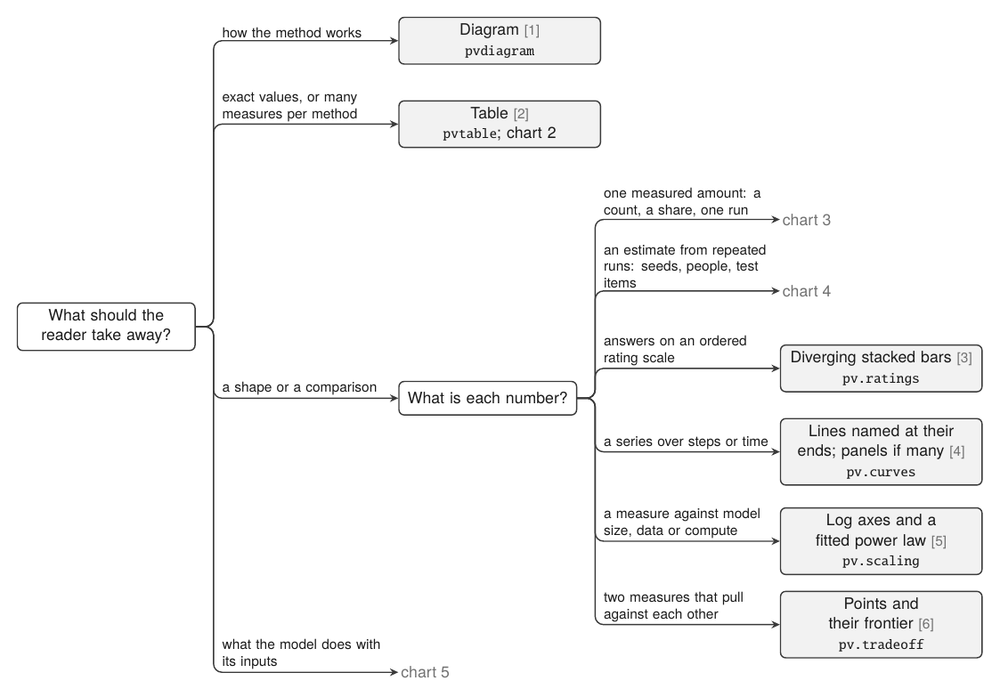
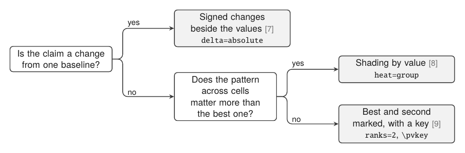
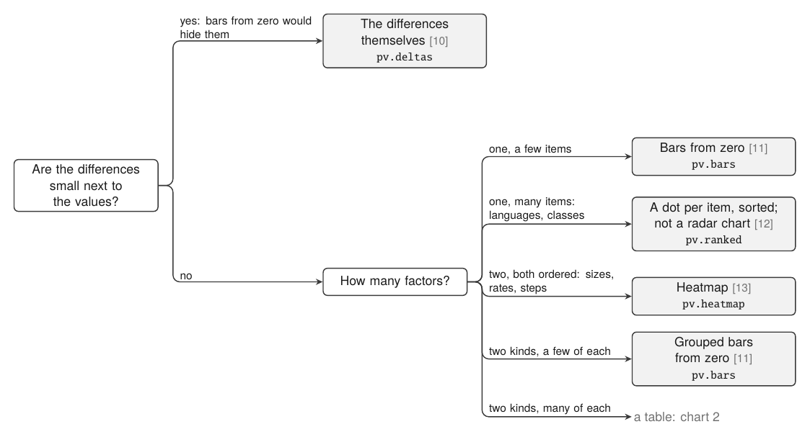
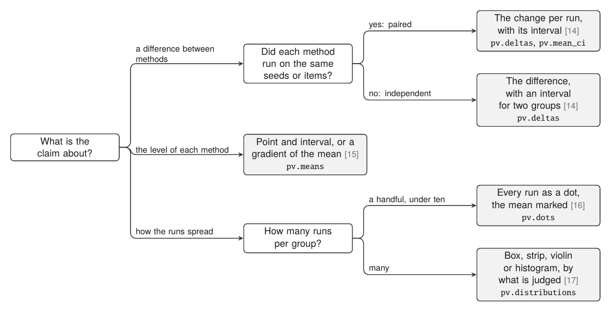
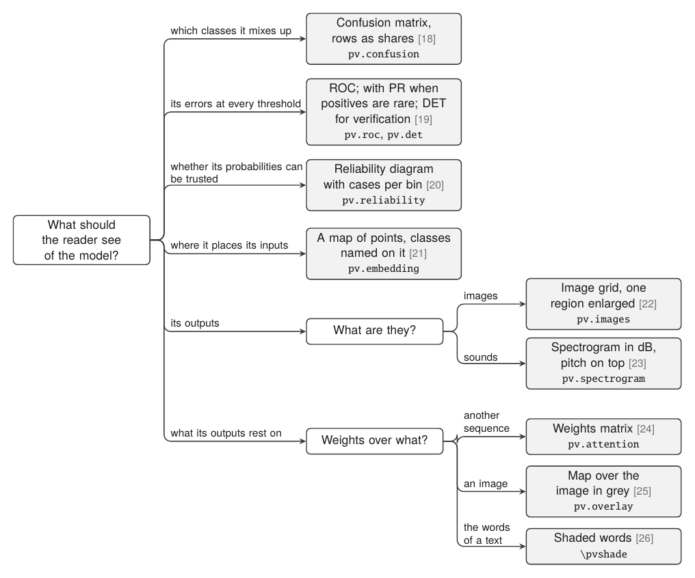

# Which exhibit to draw: a decision tree

Every result in a paper ends up as a table, a figure or a diagram. Which one
to use, and which kind, follows from a few questions: what the reader should
take away, what each number is, how many factors it varies over, and how many
values there are. The five charts below ask these questions in order; the
last one is for what a model does with its inputs, such as the classes it
confuses or the images it produces. Each
answer leads to the next question or to an exhibit, and the
[guide](guide.md) then says how to draw that exhibit.

**How to read the charts.** A white box is a question, and the words on an
arrow are one answer to it. A grey box is an exhibit, with the `pubviz`
call that draws it. The number in an exhibit box points to a note below.
Each note says what to draw and what the advice rests on:

- **Studies**: experiments or analyses in the literature, with the place in
  the paper where the finding is.
- **Our checks**: color computations in
  [`report/analysis.py`](../report/analysis.py), whose results are in
  `report/data.json`; they are computations, not studies with readers.
- **Judgment**: our choice. Nothing here tests it.

## 1. Where to start

**1. Diagram.** Steps that happen in order become boxes joined by arrows; the
parts of a model become blocks, with arrows only where data passes.
*Studies:* with arrows, people described more of how a device works and less
of its parts, and people who drew a device after reading about its function
added arrows far more often (Heiser & Tversky 2006, pp. 584–588). Of five layout
properties of a node-link diagram, only edge crossings affected both errors
and response time (Purchase 1997, Sec. 3.1). A diagram helps when it puts
information used together in one place (Larkin & Simon 1987, pp. 98–99).
*Our checks:* the light kind fills are too close to tell apart under color
vision deficiency and in grey (palettes check), so the label inside a block,
not its fill, has to name it. Draw with
[`pvdiagram`](guide.md#diagrams).

**2. Table or figure.** A table when readers will look up exact values or
compare many measures per method; a figure when the shape of the result is
the point. *Studies:* on the same data and tasks, a table was among the most
accurate and fastest forms for looking up a single value and the least
accurate for judging whether two measures are correlated (Saket et al. 2019,
Table 1, arXiv version). For spotting main effects and interactions in
2 × 2 results, line graphs were faster than tables but not more accurate
(Braithwaite & Goldstone 2013, pp. 7, 11). By worked example only, Ehrenberg
held that graphs are of little use for quantitative detail and gave rules for
readable tables (Ehrenberg 1977, pp. 281–286), and Gelman et al. found that all
but 4 of 64 tables in one journal issue could have been graphs, since papers
mostly need comparisons (Gelman et al. 2002, Fig. 8, Sec. 2.2).
*Judgment:* past about six methods or six groups, a figure is too crowded and
a table is clearer. Continue with chart 2.

**3. Answers on a rating scale.** Diverging stacked bars centered on the
neutral answer (`pv.ratings`), one bar per system; for a mean opinion score,
also the mean with its interval (`pv.means` with the tuple (mean, low,
high)). *Studies:* no reader study has compared layouts for rating data. The
diverging layout is argued for, not measured: the totals on each side then
share the zero line, which grouped bars and bars aligned at the left edge do
not give (Heiberger & Robbins 2014, p. 6, Secs. 8.1–8.2). In stacked bars,
segments without a common baseline are compared poorly (Talbot et al. 2014,
p. 2152). Ratings are ordered categories, and analyzing them as numbers gave
false alarms, misses and reversed orders in simulation (Liddell & Kruschke
2018, Figs. 2–4); all 68 psychology articles they checked did so (pp. 4–5),
as did most rating scales in NLG papers (Amidei et al. 2019, Table 2). For a
mean opinion score, ITU-T P.800.2 asks for the number of votes, the mean and
the standard deviation of each condition, and warns against comparing scores
across tests (cls. 8, 10, Table 1): one system's score fell by up to 1.28
points when it was retested among a narrower range of systems, in which it
ranked last (Cooper & Yamagishi 2023,
Table 4). *Judgment:* split the neutral answer across zero, as Heiberger &
Robbins do (p. 7), and set ties aside in win / tie / loss, where they are
about a fifth of all votes (Ameli et al. 2024, Sec. 3). See
[`ratings`](guide.md#how-people-rated-each-system-ratings).

**4. A series over steps or time.** Lines on one axis, each named at
its right end, with a band over seeds (`pv.curves`, `pv.mean_ci`). With many
series, use panels that share the y axis (`pv.figure(ncols=…)`,
`pv.panel_labels`). *Studies:* readers judge values most accurately as
positions on a common scale (Cleveland & McGill 1984, p. 536 and pp. 541,
543; Heer & Bostock 2010, p. 205). For lines, choose the axis range by the
differences that matter; cutting the axis still makes a difference look larger
(Correll et al. 2020, pp. 6, 8, 10). Readers take lines as trends: they
described all 36 line graphs in one study as trends (Zacks & Tversky 1999,
Table 1). Overlaid lines were fastest when readers compared series at the same
point of the x axis, and separate panels when the compared points lay far
apart; correctness did not differ (Javed et al. 2010, Sec. 7, Fig. 11). In an
informal follow-up with four people, the two took about the same time with
two to four series and pulled apart from about eight (Fig. 12). *Judgment:*
panels from about eight lines, or earlier when the claim compares points far
apart on the x axis. See [`curves`](guide.md#how-a-measure-moves-over-time-or-steps-curves).

**5. A measure against model size, data or compute.** Both axes
logarithmic, a power law fitted per series, solid over the points it was
fitted on and dashed beyond, held-out points hollow (`pv.scaling`).
*Studies:* ecologists read linear axes correctly 93% of the time and log–log
axes 56% (Menge et al. 2018, abstract), and a lay sample understood growth
worse on a log axis (Romano et al. 2020, Tables 2, 7); for forecasting fast
growth, one dissertation found the log axis better (Robinson 2022, abstract).
Readers who fit a trend by eye draw it too steep (Ciccione & Dehaene 2021,
Sec. 3.2.2, Fig. 5), so the fitted line is drawn rather than left to the
eye. No study tested how to mark fitted and extrapolated parts: scaling-law
papers extend fits past the data with little or no change of style (Kaplan et
al. 2020, Fig. 15; Hoffmann et al. 2022, Figs. 1–3), and the GPT-4 report
gives the held-out point its own color (OpenAI 2023, Figs. 1–2).
*Judgment:* the line styles and hollow points; state the fitted exponent in
words, since log–log axes are easy to misread. See
[`scaling`](guide.md#a-measure-against-model-size-data-or-compute-scaling).

**6. Two measures that pull against each other.** One point per method, with
a line through the methods no other method beats on both measures
(`pv.tradeoff`). *Studies:* we found no study of displays for trade-offs
between methods; scatterplots helped readers judge correlation and spot
anomalies in small datasets, a different task (Saket et al. 2019, Table 1).
Two scales in one plot area misled: with two scales of the same variable, the
chart that laid them over each other was the least accurate and slowest in
every task, and all but one participant ranked it lowest (Isenberg et al.
2011, Secs. 5–6); readers of dual-axis line charts described correlation far
more often than readers of connected scatterplots (28 against 3 statements,
counted post hoc), although line crossings there mean nothing unless both axes
share units and scale (Haroz et al. 2016, Secs. 2.2, 3.3). *Judgment:* keep
one axis per measure and never put two y axes on one plot; no study tested
twin y axes for two different measures. See
[`tradeoff`](guide.md#what-is-gained-on-one-axis-and-paid-on-another-tradeoff).

## 2. Tables

**7. A change from one baseline.** Put the signed change in small type beside
each value (`delta=absolute` or `delta=relative`, with `\pvbaseline` on the
baseline row). *Judgment,* following Gleicher et al.'s argument for computing
the relationship and showing it directly rather than leaving the subtraction
to the reader (Gleicher et al. 2011, Sec. 2). See
[a method against a baseline](guide.md#your-method-against-a-baseline).

**8. A pattern across the grid.** Shade every cell by its value within its
column or across the table (`heat=group`, `heat=table`). *Our checks:* the
table shading keeps lightness in one direction and black text above a WCAG
contrast of 10 (colormaps check). *Studies:* on a white page, darker is read
as more, and a mapping that runs the other way costs time even with a legend
in view (Schloss et al. 2019, Sec. 3). `pubviz` shades the better values
darker, so in a column where lower is better the darker cells hold the
smaller numbers, against that expectation; the key states the direction, and
whether that is enough is untested. *Judgment:* when to shade rather than mark
the best cell. See [a grid of values](guide.md#a-grid-of-values).

**9. Best and second marked, with a key.** Bold and a light fill on the best
value, a lighter fill on the second, and `\pvkey` under the table
(`ranks=2`). *Studies, on text rather than tables:* bold, a yellow
background and red text helped readers find highlighted words about equally
(0.74 to 0.78 of the highlighted words found in 13 s), and bold with a
background is a pair the authors recommend because the two barely interfere
(Strobelt et al. 2016, Fig. 3, Secs. 6.3, 8.1); in a word-search task bold was
found faster than red text (Doi 2023, Tables 2–3). Show Me leaves its
color-filled tables unranked because a fill can make the text hard to read
(Mackinlay et al. 2007, Sec. 5.2); the `pubviz` fills keep black text above
a WCAG contrast of 12 (fills check). *Judgment, untested:* no study tested
marks in table cells, the lighter second fill, or a key under a table. We add
the key because
unexplained marks are common and misread: 22 of 46 papers did not say what
their error bars were (Correll & Gleicher 2014, Sec. 2.3), and researchers
misread both kinds of error bar (Belia et al. 2005, p. 393). Values from
several runs go in as mean ± spread; the ranks use the mean (see
[mean and spread](guide.md#mean-and-spread)).

## 3. One measured amount per item

Use this chart when each number is measured once: a count, a total, a share,
or a score from a single run on a fixed test set.

**10. Small differences between large values.** Draw the differences
themselves (`pv.deltas`). *Studies:* a bar axis that does not start at zero
made readers rate the same difference as larger (Pandey et al. 2015,
Tables 1–2), and a broken-axis mark did not remove the effect (Correll et al.
2020, pp. 6, 8). So bars must start at zero, which hides a gap of 0.5 points
between scores near 90. *Judgment:* the way out is to draw the difference,
the third strategy of Gleicher et al. (2011, Sec. 2). See
[`deltas`](guide.md#how-much-each-change-helps-or-hurts-deltas).

**11. Bars from zero, single or grouped.** `pv.bars`, with the value printed on
each bar. *Studies:* readers described 28 of 33 bar graphs as comparisons
between separate values (Zacks & Tversky 1999, Table 1); bar graphs are
designed for categories (Weissgerber et al. 2015, p. 1), and Correll & Gleicher note that ratios are compared faster and more
accurately with bars than with dot plots (2014, Sec. 5, citing Cleveland &
McGill). Their problems start when a bar stands for the mean of many runs
(chart 4). *Judgment:* past about six groups or six methods, use a table. See
[`bars`](guide.md#which-method-wins-benchmark-by-benchmark-bars).

**12. One value per item, for many items.** A dot chart sorted by value,
one row per item and a marker per system (`pv.ranked`), in place of crowded
bars or a radar chart. *Studies:* no study compared sorted dot charts with
bars or radar charts for many items, or tested sorting. Cleveland proposed
dot charts as replacements for bar charts (Cleveland 1984, abstract only).
Values on radial layouts were read more slowly or less accurately than on
linear ones (Goldberg & Helfman 2011, abstract; Diehl et al. 2010,
Sec. 4.2), and among radial designs the radar chart did worst (Albo et al.
2016, abstract); a review of glyph studies found linear designs ahead in four
of seven comparisons (Fuchs et al. 2017, Sec. 4.6.4, Table 8). *Judgment:*
sort by ours, one marker shape per system, and an axis that need not start
at zero, since a dot has no length. See
[`ranked`](guide.md#one-value-per-item-for-many-items-ranked).

**13. Heatmap.** When both factors are ordered (model size by data size, a
learning-rate sweep), the grid reads as a surface (`pv.heatmap`). *Our
checks:* its colormap keeps lightness in one direction, so a grey print keeps
the order (colormaps check). *Judgment:* a heatmap rather than a table
when the surface matters more than single cells. See
[`heatmap`](guide.md#values-over-two-factors-heatmap).

## 4. An estimate from repeated runs

Use this chart when each number is a mean over runs: seeds, participants, or
test items.

**14. A difference between methods.** Draw the difference with its own
interval (`pv.deltas`), not two intervals side by side.
*Studies:* for repeated measures, the intervals of the separate means say
nothing about the difference, and no rule based on their overlap exists
(Cumming & Finch 2005, pp. 176–177); for independent groups the overlap rule
holds only with at least 10 cases per group and similar margins (p. 176).
Researchers asked to place two means "just significantly different" got it
wrong with both interval and standard-error bars (Belia et al. 2005, p. 393).
Ho et al. argue for drawing the difference beside the data (Ho et al. 2019,
"estimation plots"), but no study has tested how readers take a drawn
difference; Hofman et al. list it as untested (2020, Discussion).
*How:* when both methods ran on the same seeds or items, take the difference
per run and its interval with `pv.mean_ci`; when they did not, combine the two
margins as √(w₁² + w₂²), an approximation for independent groups.

**15. The level of each method.** A point with its interval, or a gradient
of the mean's uncertainty, with the runs drawn faintly underneath
(`pv.means`); not a bar. *Studies:* with bars and error bars, readers judged
values inside the bar likelier than values above it and read the interval as
all-or-nothing (Correll & Gleicher 2014, Secs. 4.2, 4.4, 5). Shown only the
interval of a mean, readers overstate effects: crowd workers put the chance
that a treated case beats a control at 86% with 95% confidence intervals and
67% with prediction intervals, against a true 57% (Hofman et al. 2020, p. 5).
Data scientists shown standard errors put it at 76%, and 61% when every data
point was drawn too, against a true 59% (Zhang et al. 2023, Fig. 3). Among
researchers, gradient and violin displays of an interval halved the drop in
confidence around p = .05 compared with a plain interval (0.15 against 0.29),
with no difference between the two (Helske et al. 2021, Fig. 4); readers there
took the violin of the mean for a violin of the data, so `pubviz` draws the
gradient. A box plot misleads for the same reason (Correll & Gleicher 2014,
Sec. 3.4).

**16. A handful of runs.** Draw every run as a dot and mark the mean
(`pv.dots`).
*Studies:* in samples of two to six, scatterplots of every value are the best
choice, because box plots and histograms are hard to read and summary
statistics are only meaningful when there are enough data to summarize
(Weissgerber et al. 2015, pp. 5–6). Different data can give the same bar
(Figs. 1–2). With five points the shape of a distribution cannot be told
apart, and dots should be jittered so none hides another (Weissgerber et al.
2019, Figs. 4, 7). No reader study used three to ten runs, the usual number
of seeds. *Judgment:* "a handful" as under about ten; Weissgerber et al.
(2019) find "no clear guidelines" for the size at which a summary becomes
meaningful.

**17. Many runs.** Choose by what the reader should judge
(`pv.distributions`): a box for the median and for comparing methods, a strip
of every run for the range and the spread, a violin for the shape, such as
two peaks; `points=True` lays the runs over a box or violin. It warns when a
method has fewer than about ten runs. *Studies:* with 200 points per chart,
box plots were best for the median and for comparing two groups and worst for
the range, and most readers took the box for a cluster of values; strip plots
were best for the range and violins for clusters (Lotteraner et al. 2026,
Sec. 4, read in the arXiv version). Strip plots also gave the best estimates
of spread, with a 21.9% error against 30.6–32.2% for the other kinds
(Newburger et al. 2023, Table 1). Weissgerber et al. advise laying the dots
over a box plot when the sample is not large (2019, Fig. 3).

## 5. What a model does

Use this chart when the reader should see the model at work: the classes it
confuses, its errors over every threshold, the pictures or sounds it
produces, or what its outputs rest on. Fewer studies reach these exhibits;
most of the support is methodological argument, and the notes say where.

**18. Which classes it mixes up.** A confusion matrix with rows as shares of
each true class, counts beside the shares for a few classes, empty cells as
dashes, the diagonal outlined (`pv.confusion`). *Studies:* lay readers did
better with the task's own labels than with generic terms (Shen et al. 2020,
Table 2). In a think-aloud study, all but one user swapped false negatives
and false positives when rows and columns looked alike, and found counts
easier than rates (Beauxis-Aussalet et al. 2019, Secs. 7.4–7.5). With 24
practitioners, a plain count matrix was slower and less accurate than an
alternative design, more so at 15 classes (Ren et al. 2017, Sec. 6.5,
Fig. 9). Normalizing rows reveals confusions that unequal class sizes hide,
an argument without a study (Görtler et al. 2022, Secs. 4.1, 6.1); no study
has tested counts against shares, the diagonal or the color scale (Ren et
al. 2017, Sec. 7.1). *Judgment:* the scale fixed at 0–100%, both numbers up
to six classes, the outlined diagonal. See
[`confusion`](guide.md#which-classes-are-mixed-up-confusion).

**19. Its errors at every threshold.** An ROC curve with the chance diagonal;
with rare positives also a precision–recall curve with the share of
positives as its baseline; for verification a DET curve (`pv.roc`,
`pv.precision_recall`, `pv.det`). *Studies,* methodological only: no reader
study of these displays was found. An ROC curve does not change with class
balance and a precision–recall curve does (Fawcett 2006, Sec. 4.2, Fig. 5);
on skewed data, ROC curves can look nearly perfect while precision–recall
curves show much room to improve (Davis & Goadrich 2006, Sec. 1, Fig. 1).
Joining precision–recall points with straight lines overstates the area
(Sec. 4, Fig. 6). The baseline of a precision–recall plot is the share of
positives (Saito & Rehmsmeier 2015, p. 7), and of 58 articles on imbalanced
data they examined, 35 used ROC and 4 used precision–recall (Table 4). One
area can hide where two curves differ (Fawcett 2006, Sec. 7, Fig. 8). DET
curves put both error rates on normal-deviate scales, so that good systems
spread out instead of bunching in a corner (Martin et al. 1997).
*Judgment:* equal axis scales and the summary printed beside each name. See
[the classifier curves](guide.md#how-a-classifier-trades-its-errors-roc-precision_recall-det-reliability).

**20. Whether its probabilities can be trusted.** A reliability diagram with
the number of cases per bin under it (`pv.reliability`). *Studies,*
methodological only: plot each bin at its mean prediction, not its center
(Bröcker & Smith 2007, Sec. 2); the diagram alone does not show how many
cases each bin holds (Guo et al. 2017, Sec. 2), and with 9, 10 or 11 bins the
same forecasts gave very different diagrams (Dimitriadis et al. 2021,
Fig. 2). *Judgment:* ten equal bins and a count panel; `pubviz` does not yet
draw the consistency bands Bröcker & Smith propose (Sec. 2a).

**21. Where it places its inputs.** A 2-D map of points, each class named on
the map, no axis values (`pv.embedding`). *Studies:* in t-SNE maps, cluster
sizes and the distances between clusters may mean nothing (Wattenberg et al.
2016, Secs. 2–3), and where an isolated cluster lands depends on the random
seed (Kobak & Berens 2019, Fig. 1); on cell data, t-SNE and UMAP kept few of
each point's true neighbors (Chari & Pachter 2023, Fig. 2). Readers found
clusters in such maps well but chose the nearest or the densest cluster
correctly less than half the time (Xia et al. 2022, Sec. 6.3.1, Fig. 4).
In colored scatterplots, accuracy fell as categories were added, and the
authors advise care above all from six categories on (Tseng et al. 2023,
Secs. 4.1, 5.2). *Judgment:* class names on the
map instead of a legend, which no study has compared. See
[`embedding`](guide.md#where-a-model-puts-its-inputs-embedding).

**22. Its outputs, as images.** One row per example and one column per
method, the same region enlarged under every image, and optionally each
output's difference from the reference (`pv.images`). *Studies:* in a flicker
task, viewers missed even large changes between two photographs until told
where to look (Rensink et al. 1997, p. 370, Exp. 3). In interactive viewers,
separate windows shown together beat zooming in and out once a pattern had
more than three or four parts (Plumlee & Ware 2006, Table I), and magnified
insets made comparisons 22 to 32 points more accurate than outlined boxes
alone (Lekschas et al. 2020, Sec. 6.1).
A difference image beside a pair of chest radiographs raised radiologists'
detection (Difazio et al. 1997, abstract). Random examples give the least
biased picture (van Miltenburg et al. 2021, Sec. 4.2), and few papers show
failures (Gehrmann et al. 2023, Table 1). *Judgment:* crops placed under the
images rather than joined by leader lines, which hurt one task in Lekschas et
al. (Sec. 6.1). See [`images`](guide.md#the-same-examples-as-each-method-gives-them-images).

**23. Its outputs, as sounds.** A spectrogram in dB down to a fixed floor,
white for quiet and near black for loud, with the pitch contour on top
(`pv.spectrogram`, `pv.waveform`). *Studies:* we found no study of
spectrogram displays. In another field, medical students found more regions
of interest with a diverging map than with a rainbow map, while preferring
the rainbow (Borkin et al. 2011, Sec. 6.5); jet creates false edges (Thyng et
al. 2016, p. 9). Praat draws 50 dB below the peak and librosa 80 dB (tool
defaults). *Our checks:* the lightness ramp is monotone (colormaps check).
*Judgment:* the −80 dB floor and the grey ramp, which follows Praat and the
dark-is-more reading of Schloss et al. (2019, Sec. 3). See
[`spectrogram`](guide.md#a-sound-over-time-spectrogram-waveform).

**24. Weights over another sequence.** A matrix of weights, darker for
larger, without numbers (`pv.attention`). *Studies* of models, not readers:
attention agreed only weakly with other measures of which inputs matter, and
very different attention gave the same output (Jain & Wallace 2019,
Secs. 4.1–4.2); learned attention still carries some signal (Wiegreffe &
Pinter 2019, Sec. 3.4). In the upper layers of a Transformer, raw attention
is close to uniform (Abnar & Zuidema 2020, Sec. 2), and in translation it can
sit one word off the alignment (Koehn & Knowles 2017, Sec. 3.5). We found no
reader study of these matrices. *Judgment:* name the layer and heads, and
claim only the pattern. See
[`attention`](guide.md#how-strongly-items-of-two-sequences-attend-to-each-other-attention).

**25. Weights over an image.** The map laid over the image in grey, opacity
growing with the weight, two hues for a signed map (`pv.overlay`).
*Studies:* some saliency methods give nearly the same map after the model's
weights are randomized, and showing only the size of a signed map hides where
its sign flips (Adebayo et al. 2018, Secs. 3–4, Fig. 4). On a bird
dataset, readers judged Grad-CAM explanations convincing for 67% of wrong
predictions and 72% of right ones (Kim et al. 2022, Table 1); maps raised readers' prediction of
the model only from 55% to 61% (Alqaraawi et al. 2020, Sec. 4.1). Where the
color scale is cut off changed how well readers thought a map matched the
object (Zhao et al. 2023, Sec. 6.2.2). Readers take a more opaque color as
more (Schloss et al. 2019, abstract). No study tested the opacity of an
overlay. See [`overlay`](guide.md#which-parts-of-an-image-a-prediction-rests-on-overlay).

**26. Weights over the words of a text.** Each word shaded by its weight in
the paper's own text (`\pvshade`, written by `pv.pvshade`). *Studies:*
readers judged longer words as more important at the same shade, up to
about eight letters, and read very pale shades as none (Schuff et al. 2022,
Sec. 5.1, Table 3); a word's neighbors shift how it is read (Jacovi et al.
2023, Sec. 4). Bars beside the words removed the length effect (Schuff et
al. 2022, Sec. 6.3). On text in general, a background color and bold barely
interfere (Strobelt et al. 2016, Sec. 8.1). *Judgment:* shading rather than
bars, since it keeps the sentence readable; negative weights also
underlined. See [`\pvshade`](guide.md#weights-over-the-words-of-a-sentence-pvshade).

## Then: colors

Once the exhibit is chosen, its colors follow from what they stand for.

| The colors stand for | Use | Basis |
| --- | --- | --- |
| An order or a size | One hue, lightness changing in one direction (`heat=`, `pv.heatmap`) | *Studies:* among Liu & Heer's maps, jet gave the most errors and viridis the fewest (Liu & Heer 2018, Results); on white, darker is read as more (Schloss et al. 2019, Sec. 3). *Our checks:* jet and turbo turn back in lightness by more than 50 points, so a grey print reorders them (colormaps check). |
| A change that helps or hurts | Green and red, with the sign printed | *Studies:* the meaning of red is learned: Chinese stockbrokers, for whom red marks a rising price, did better after a red cue and students worse (Zhang & Han 2014, Results). *Judgment:* print the sign, so the meaning never rests on color ([guide](guide.md#rules-every-exhibit-shares), rule 3). |
| Categories | A few hues, each named on the plot; checked for color vision deficiency and grey | *Studies:* small marks need larger color differences (Szafir 2018, Secs. 5.2, 8); about 8% of men and 0.5% of women have a color vision deficiency (Crameri et al. 2020, Introduction). *Our checks:* matplotlib's first six colors nearly merge under simulated protanopia, and two Okabe–Ito colors merge in grey (palettes check). |
| A level, such as loudness or error | White to near black in even lightness steps (`pv.spectrogram`, the error maps of `pv.images`) | *Studies:* on white, darker is read as more (Schloss et al. 2019, Sec. 3). *Our checks:* the level map spans about 80 lightness points in nearly even steps and never turns back (colormaps check). |
| The paper's own result | The accent on it, grey on the rest | *Judgment,* following visual-search studies that did not use charts: a target whose color lies far from every other color is found fastest (Wolfe & Horowitz 2004, p. 498, Fig. 5), and fewer distinct colors make the odd one out easier to find (Haroz & Whitney 2012, Secs. 4–5). |

## What the tree rests on

The studies behind it mostly used simple stimuli with crowd workers or
students, such as one ratio between two marks or isolated color patches;
how far their effects reach expert readers of real papers is untested. Branches marked judgment, and the thresholds (six groups, eight
lines, ten runs), are our rules of thumb. The tree covers the results of
empirical papers and what a model does; it does not cover maps or networks.

## References

- Abnar & Zuidema (2020). Quantifying Attention Flow in Transformers. *Proceedings of the 58th Annual Meeting of the Association for Computational Linguistics*. [doi:10.18653/v1/2020.acl-main.385](https://doi.org/10.18653/v1/2020.acl-main.385)
- Adebayo et al. (2018). Sanity Checks for Saliency Maps. *Advances in Neural Information Processing Systems*. [arXiv:1810.03292](https://arxiv.org/abs/1810.03292)
- Albo, Lanir, Bak & Rafaeli (2016). Off the Radar: Comparative Evaluation of Radial Visualization Solutions for Composite Indicators. *IEEE Transactions on Visualization and Computer Graphics* 22(1). [doi:10.1109/TVCG.2015.2467322](https://doi.org/10.1109/TVCG.2015.2467322)
- Alqaraawi, Schuessler, Weiß, Costanza & Berthouze (2020). Evaluating Saliency Map Explanations for Convolutional Neural Networks: A User Study. *Proceedings of the 25th International Conference on Intelligent User Interfaces*. [doi:10.1145/3377325.3377519](https://doi.org/10.1145/3377325.3377519)
- Ameli, Zhuang, Stoica & Mahoney (2024). A Statistical Framework for Ranking LLM-Based Chatbots. [arXiv:2412.18407](https://arxiv.org/abs/2412.18407)
- Amidei, Piwek & Willis (2019). The use of rating and Likert scales in Natural Language Generation human evaluation tasks: A review and some recommendations. *Proceedings of the 12th International Conference on Natural Language Generation*. [doi:10.18653/v1/W19-8648](https://doi.org/10.18653/v1/W19-8648)
- Beauxis-Aussalet, Van Doorn & Hardman (2019). Supporting End-User Understanding of Classification Errors: Visualization and Usability Issues. *The Journal of Interaction Science* 7. [doi:10.24982/jois.1814019.003](https://doi.org/10.24982/jois.1814019.003)
- Belia, Fidler, Williams & Cumming (2005). Researchers misunderstand confidence intervals and standard error bars. *Psychological Methods* 10(4). [doi:10.1037/1082-989X.10.4.389](https://doi.org/10.1037/1082-989X.10.4.389)
- Boersma & Weenink (2026). Praat Manual: Intro 3.2. Configuring the Spectrogram; Advanced Spectrogram Settings. [link](https://www.fon.hum.uva.nl/praat/manual/Intro_3_2__Configuring_the_spectrogram.html)
- Borkin et al. (2011). Evaluation of Artery Visualizations for Heart Disease Diagnosis. *IEEE Transactions on Visualization and Computer Graphics* 17(12). [doi:10.1109/TVCG.2011.192](https://doi.org/10.1109/TVCG.2011.192)
- Braithwaite & Goldstone (2013). Flexibility in data interpretation: effects of representational format. *Frontiers in Psychology* 4. [doi:10.3389/fpsyg.2013.00980](https://doi.org/10.3389/fpsyg.2013.00980)
- Bröcker & Smith (2007). Increasing the Reliability of Reliability Diagrams. *Weather and Forecasting* 22(3). [doi:10.1175/WAF993.1](https://doi.org/10.1175/WAF993.1)
- Chari & Pachter (2023). The Specious Art of Single-Cell Genomics. *PLOS Computational Biology* 19(8). [doi:10.1371/journal.pcbi.1011288](https://doi.org/10.1371/journal.pcbi.1011288)
- Ciccione & Dehaene (2021). Can humans perform mental regression on a graph? Accuracy and bias in the perception of scatterplots. *Cognitive Psychology* 128. [doi:10.1016/j.cogpsych.2021.101406](https://doi.org/10.1016/j.cogpsych.2021.101406)
- Cleveland & McGill (1984). Graphical perception. *JASA* 79(387). [doi:10.1080/01621459.1984.10478080](https://doi.org/10.1080/01621459.1984.10478080)
- Cleveland (1984). Graphical Methods for Data Presentation: Full Scale Breaks, Dot Charts, and Multibased Logging. *The American Statistician* 38(4). [doi:10.1080/00031305.1984.10483224](https://doi.org/10.1080/00031305.1984.10483224)
- Cooper & Yamagishi (2023). Investigating Range-Equalizing Bias in Mean Opinion Score Ratings of Synthesized Speech. *Interspeech 2023*. [doi:10.21437/Interspeech.2023-1076](https://doi.org/10.21437/Interspeech.2023-1076)
- Correll & Gleicher (2014). Error bars considered harmful. *IEEE TVCG* 20(12). [doi:10.1109/TVCG.2014.2346298](https://doi.org/10.1109/TVCG.2014.2346298)
- Correll, Bertini & Franconeri (2020). Truncating the y-axis: threat or menace? *CHI*. [doi:10.1145/3313831.3376222](https://doi.org/10.1145/3313831.3376222)
- Crameri, Shephard & Heron (2020). The misuse of colour in science communication. *Nature Communications* 11. [doi:10.1038/s41467-020-19160-7](https://doi.org/10.1038/s41467-020-19160-7)
- Cumming & Finch (2005). Inference by eye. *American Psychologist* 60(2). [doi:10.1037/0003-066X.60.2.170](https://doi.org/10.1037/0003-066X.60.2.170)
- Davis & Goadrich (2006). The relationship between Precision-Recall and ROC curves. *Proceedings of the 23rd International Conference on Machine Learning (ICML '06)*. [doi:10.1145/1143844.1143874](https://doi.org/10.1145/1143844.1143874)
- Diehl, Beck & Burch (2010). Uncovering Strengths and Weaknesses of Radial Visualizations–-An Empirical Approach. *IEEE Transactions on Visualization and Computer Graphics* 16(6). [doi:10.1109/TVCG.2010.209](https://doi.org/10.1109/TVCG.2010.209)
- Difazio et al. (1997). Digital Chest Radiography: Effect of Temporal Subtraction Images on Detection Accuracy. *Radiology* 202(2). [doi:10.1148/radiology.202.2.9015072](https://doi.org/10.1148/radiology.202.2.9015072)
- Dimitriadis, Gneiting & Jordan (2021). Stable reliability diagrams for probabilistic classifiers. *Proceedings of the National Academy of Sciences* 118(8). [doi:10.1073/pnas.2016191118](https://doi.org/10.1073/pnas.2016191118)
- Doi (2023). Effective highlighting modes of graphical user interfaces in visual information search. *Universal Access in the Information Society* 22(1). [doi:10.1007/s10209-021-00827-x](https://doi.org/10.1007/s10209-021-00827-x)
- Ehrenberg (1977). Rudiments of numeracy. *JRSS A* 140(3). [doi:10.2307/2344922](https://doi.org/10.2307/2344922)
- Fawcett (2006). An introduction to ROC analysis. *Pattern Recognition Letters* 27(8). [doi:10.1016/j.patrec.2005.10.010](https://doi.org/10.1016/j.patrec.2005.10.010)
- Fuchs, Isenberg, Bezerianos & Keim (2017). A Systematic Review of Experimental Studies on Data Glyphs. *IEEE Transactions on Visualization and Computer Graphics* 23(7). [doi:10.1109/TVCG.2016.2549018](https://doi.org/10.1109/TVCG.2016.2549018)
- Gehrmann, Clark & Sellam (2023). Repairing the Cracked Foundation: A Survey of Obstacles in Evaluation Practices for Generated Text. *Journal of Artificial Intelligence Research* 77. [doi:10.1613/jair.1.13715](https://doi.org/10.1613/jair.1.13715)
- Gelman, Pasarica & Dodhia (2002). Let's practice what we preach. *The American Statistician* 56(2). [doi:10.1198/000313002317572790](https://doi.org/10.1198/000313002317572790)
- Gleicher et al. (2011). Visual comparison for information visualization. *Information Visualization* 10(4). [doi:10.1177/1473871611416549](https://doi.org/10.1177/1473871611416549)
- Goldberg & Helfman (2011). Eye Tracking for Visualization Evaluation: Reading Values on Linear versus Radial Graphs. *Information Visualization* 10(3). [doi:10.1177/1473871611406623](https://doi.org/10.1177/1473871611406623)
- Görtler et al. (2022). Neo: Generalizing Confusion Matrix Visualization to Hierarchical and Multi-Output Labels. *CHI Conference on Human Factors in Computing Systems*. [doi:10.1145/3491102.3501823](https://doi.org/10.1145/3491102.3501823)
- Guo, Pleiss, Sun & Weinberger (2017). On Calibration of Modern Neural Networks. *International Conference on Machine Learning*. [arXiv:1706.04599](https://arxiv.org/abs/1706.04599)
- Haroz & Whitney (2012). How capacity limits of attention influence information visualization effectiveness. *IEEE TVCG* 18(12). [doi:10.1109/TVCG.2012.233](https://doi.org/10.1109/TVCG.2012.233)
- Haroz, Kosara & Franconeri (2016). The connected scatterplot for presenting paired time series. *IEEE TVCG* 22(9). [doi:10.1109/TVCG.2015.2502587](https://doi.org/10.1109/TVCG.2015.2502587)
- Heer & Bostock (2010). Crowdsourcing graphical perception. *CHI*. [doi:10.1145/1753326.1753357](https://doi.org/10.1145/1753326.1753357)
- Heiberger & Robbins (2014). Design of Diverging Stacked Bar Charts for Likert Scales and Other Applications. *Journal of Statistical Software* 57(5). [doi:10.18637/jss.v057.i05](https://doi.org/10.18637/jss.v057.i05)
- Heiser & Tversky (2006). Arrows in comprehending and producing mechanical diagrams. *Cognitive Science* 30(3). [doi:10.1207/s15516709cog0000_70](https://doi.org/10.1207/s15516709cog0000_70)
- Helske, Helske, Cooper, Ynnerman & Besançon (2021). Can visualization alleviate dichotomous thinking? *IEEE TVCG* 27(8). [doi:10.1109/TVCG.2021.3073466](https://doi.org/10.1109/TVCG.2021.3073466)
- Ho, Tumkaya, Aryal, Choi & Claridge-Chang (2019). Moving beyond P values: data analysis with estimation graphics. *Nature Methods* 16(7). [doi:10.1038/s41592-019-0470-3](https://doi.org/10.1038/s41592-019-0470-3)
- Hoffmann et al. (2022). Training Compute-Optimal Large Language Models. [arXiv:2203.15556](https://arxiv.org/abs/2203.15556)
- Hofman, Goldstein & Hullman (2020). How visualizing inferential uncertainty can mislead readers about treatment effects in scientific results. *CHI*. [doi:10.1145/3313831.3376454](https://doi.org/10.1145/3313831.3376454)
- Isenberg, Bezerianos, Dragicevic & Fekete (2011). A study on dual-scale data charts. *IEEE TVCG* 17(12). [doi:10.1109/TVCG.2011.160](https://doi.org/10.1109/TVCG.2011.160)
- ITU-T (2016). Mean opinion score interpretation and reporting. *Recommendation P.800.2, International Telecommunication Union*. [link](https://www.itu.int/rec/T-REC-P.800.2)
- Jacovi, Schuff, Adel, Vu & Goldberg (2023). Neighboring Words Affect Human Interpretation of Saliency Explanations. *Findings of the Association for Computational Linguistics: ACL 2023*. [doi:10.18653/v1/2023.findings-acl.750](https://doi.org/10.18653/v1/2023.findings-acl.750)
- Jain & Wallace (2019). Attention is not Explanation. *Proceedings of the 2019 Conference of the North American Chapter of the Association for Computational Linguistics: Human Language Technologies, Volume 1 (Long and Short Papers)*. [doi:10.18653/v1/N19-1357](https://doi.org/10.18653/v1/N19-1357)
- Javed, McDonnel & Elmqvist (2010). Graphical perception of multiple time series. *IEEE TVCG* 16(6). [doi:10.1109/TVCG.2010.162](https://doi.org/10.1109/TVCG.2010.162)
- Kaplan et al. (2020). Scaling Laws for Neural Language Models. [arXiv:2001.08361](https://arxiv.org/abs/2001.08361)
- Kim, Meister, Ramaswamy, Fong & Russakovsky (2022). HIVE: Evaluating the Human Interpretability of Visual Explanations. *Computer Vision – ECCV 2022*. [doi:10.1007/978-3-031-19775-8_17](https://doi.org/10.1007/978-3-031-19775-8_17)
- Kobak & Berens (2019). The Art of Using t-SNE for Single-Cell Transcriptomics. *Nature Communications* 10(1). [doi:10.1038/s41467-019-13056-x](https://doi.org/10.1038/s41467-019-13056-x)
- Koehn & Knowles (2017). Six Challenges for Neural Machine Translation. *Proceedings of the First Workshop on Neural Machine Translation*. [doi:10.18653/v1/W17-3204](https://doi.org/10.18653/v1/W17-3204)
- Larkin & Simon (1987). Why a diagram is (sometimes) worth ten thousand words. *Cognitive Science* 11(1). [doi:10.1111/j.1551-6708.1987.tb00863.x](https://doi.org/10.1111/j.1551-6708.1987.tb00863.x)
- Lekschas et al. (2020). Pattern-Driven Navigation in 2D Multiscale Visualizations with Scalable Insets. *IEEE Transactions on Visualization and Computer Graphics* 26(1). [doi:10.1109/TVCG.2019.2934555](https://doi.org/10.1109/TVCG.2019.2934555)
- Liddell & Kruschke (2018). Analyzing ordinal data with metric models: What could possibly go wrong? *Journal of Experimental Social Psychology* 79. [doi:10.1016/j.jesp.2018.08.009](https://doi.org/10.1016/j.jesp.2018.08.009)
- Liu & Heer (2018). Somewhere over the rainbow. *CHI*. [doi:10.1145/3173574.3174172](https://doi.org/10.1145/3173574.3174172)
- Lotteraner, Kurtenkova, Möller & Pahr (2026). Investigating performance and practices with univariate distribution charts. *Computer Graphics Forum*, e70482; read in the arXiv version 2604.08378. [doi:10.1111/cgf.70482](https://doi.org/10.1111/cgf.70482)
- Mackinlay, Hanrahan & Stolte (2007). Show Me: automatic presentation for visual analysis. *IEEE TVCG* 13(6). [doi:10.1109/TVCG.2007.70594](https://doi.org/10.1109/TVCG.2007.70594)
- Martin, Doddington, Kamm, Ordowski & Przybocki (1997). The DET curve in assessment of detection task performance. *5th European Conference on Speech Communication and Technology (Eurospeech 1997)*. [doi:10.21437/Eurospeech.1997-504](https://doi.org/10.21437/Eurospeech.1997-504)
- Menge et al. (2018). Logarithmic scales in ecological data presentation may cause misinterpretation. *Nature Ecology & Evolution* 2(9). [doi:10.1038/s41559-018-0610-7](https://doi.org/10.1038/s41559-018-0610-7)
- Newburger, Correll & Elmqvist (2023). Fitting bell curves to data distributions using visualization. *IEEE TVCG* 29(12). [doi:10.1109/TVCG.2022.3210763](https://doi.org/10.1109/TVCG.2022.3210763)
- OpenAI (2023). GPT-4 Technical Report. [arXiv:2303.08774](https://arxiv.org/abs/2303.08774)
- Pandey et al. (2015). How deceptive are deceptive visualizations? *CHI*. [doi:10.1145/2702123.2702608](https://doi.org/10.1145/2702123.2702608)
- Plumlee & Ware (2006). Zooming versus Multiple Window Interfaces: Cognitive Costs of Visual Comparisons. *ACM Transactions on Computer-Human Interaction* 13(2). [doi:10.1145/1165734.1165736](https://doi.org/10.1145/1165734.1165736)
- Purchase (1997). Which aesthetic has the greatest effect on human understanding? *Graph Drawing*, LNCS 1353. [doi:10.1007/3-540-63938-1_67](https://doi.org/10.1007/3-540-63938-1_67)
- Ren, Amershi, Lee, Suh & Williams (2017). Squares: Supporting Interactive Performance Analysis for Multiclass Classifiers. *IEEE Transactions on Visualization and Computer Graphics* 23(1). [doi:10.1109/TVCG.2016.2598828](https://doi.org/10.1109/TVCG.2016.2598828)
- Rensink, O'Regan & Clark (1997). To See or not to See: The Need for Attention to Perceive Changes in Scenes. *Psychological Science* 8(5). [doi:10.1111/j.1467-9280.1997.tb00427.x](https://doi.org/10.1111/j.1467-9280.1997.tb00427.x)
- Robinson (2022). Human Perception of Exponentially Increasing Data Displayed on a Log Scale Evaluated Through Experimental Graphics Tasks. *University of Nebraska–Lincoln*. [link](https://digitalcommons.unl.edu/dissertations/AAI29257475)
- Romano, Sotis, Dominioni & Guidi (2020). The scale of COVID-19 graphs affects understanding, attitudes, and policy preferences. *Health Economics* 29(11). [doi:10.1002/hec.4143](https://doi.org/10.1002/hec.4143)
- Saito & Rehmsmeier (2015). The Precision-Recall Plot Is More Informative than the ROC Plot When Evaluating Binary Classifiers on Imbalanced Datasets. *PLOS ONE* 10(3). [doi:10.1371/journal.pone.0118432](https://doi.org/10.1371/journal.pone.0118432)
- Saket, Endert & Demiralp (2019). Task-based effectiveness of basic visualizations. *IEEE TVCG* 25(7); read in the arXiv version 1709.08546v3. [doi:10.1109/TVCG.2018.2829750](https://doi.org/10.1109/TVCG.2018.2829750)
- Schloss, Gramazio, Silverman, Parker & Wang (2019). Mapping color to meaning in colormap data visualizations. *IEEE TVCG* 25(1). [doi:10.1109/TVCG.2018.2865147](https://doi.org/10.1109/TVCG.2018.2865147)
- Schuff, Jacovi, Adel, Goldberg & Vu (2022). Human Interpretation of Saliency-based Explanation Over Text. *2022 ACM Conference on Fairness, Accountability, and Transparency*. [doi:10.1145/3531146.3533127](https://doi.org/10.1145/3531146.3533127)
- Shen et al. (2020). Designing Alternative Representations of Confusion Matrices to Support Non-Expert Public Understanding of Algorithm Performance. *Proceedings of the ACM on Human-Computer Interaction* 4(CSCW2). [doi:10.1145/3415224](https://doi.org/10.1145/3415224)
- Strobelt, Oelke, Kwon, Schreck & Pfister (2016). Guidelines for effective usage of text highlighting techniques. *IEEE TVCG* 22(1). [doi:10.1109/TVCG.2015.2467759](https://doi.org/10.1109/TVCG.2015.2467759)
- Szafir (2018). Modeling color difference for visualization design. *IEEE TVCG* 24(1). [doi:10.1109/TVCG.2017.2744359](https://doi.org/10.1109/TVCG.2017.2744359)
- Talbot, Setlur & Anand (2014). Four Experiments on the Perception of Bar Charts. *IEEE Transactions on Visualization and Computer Graphics* 20(12). [doi:10.1109/TVCG.2014.2346320](https://doi.org/10.1109/TVCG.2014.2346320)
- The librosa development team (2026). librosa (power_to_db, main branch, version 1.1.0dev). [link](https://github.com/librosa/librosa/blob/main/librosa/core/spectrum.py)
- Thyng, Greene, Hetland, Zimmerle & DiMarco (2016). True Colors of Oceanography: Guidelines for Effective and Accurate Colormap Selection. *Oceanography* 29(3). [doi:10.5670/oceanog.2016.66](https://doi.org/10.5670/oceanog.2016.66)
- Tseng, Quadri, Wang & Szafir (2023). Measuring Categorical Perception in Color-Coded Scatterplots. *Proceedings of the 2023 CHI Conference on Human Factors in Computing Systems*. [doi:10.1145/3544548.3581416](https://doi.org/10.1145/3544548.3581416)
- van Miltenburg et al. (2021). Underreporting of Errors in NLG Output, and What to Do About It. *Proceedings of the 14th International Conference on Natural Language Generation*. [doi:10.18653/v1/2021.inlg-1.14](https://doi.org/10.18653/v1/2021.inlg-1.14)
- Wattenberg, Viégas & Johnson (2016). How to Use t-SNE Effectively. *Distill* 1(10). [doi:10.23915/distill.00002](https://doi.org/10.23915/distill.00002)
- Weissgerber et al. (2019). Reveal, don't conceal: transforming data visualization to improve transparency. *Circulation* 140(18). [doi:10.1161/CIRCULATIONAHA.118.037777](https://doi.org/10.1161/CIRCULATIONAHA.118.037777)
- Weissgerber, Milic, Winham & Garovic (2015). Beyond bar and line graphs. *PLOS Biology* 13(4). [doi:10.1371/journal.pbio.1002128](https://doi.org/10.1371/journal.pbio.1002128)
- Wiegreffe & Pinter (2019). Attention is not not Explanation. *Proceedings of the 2019 Conference on Empirical Methods in Natural Language Processing and the 9th International Joint Conference on Natural Language Processing (EMNLP-IJCNLP)*. [doi:10.18653/v1/D19-1002](https://doi.org/10.18653/v1/D19-1002)
- Wolfe & Horowitz (2004). What attributes guide the deployment of visual attention and how do they do it? *Nature Reviews Neuroscience* 5(6). [doi:10.1038/nrn1411](https://doi.org/10.1038/nrn1411)
- Xia et al. (2022). Revisiting Dimensionality Reduction Techniques for Visual Cluster Analysis: An Empirical Study. *IEEE Transactions on Visualization and Computer Graphics* 28(1). [doi:10.1109/TVCG.2021.3114694](https://doi.org/10.1109/TVCG.2021.3114694)
- Zacks & Tversky (1999). Bars and lines: a study of graphic communication. *Memory & Cognition* 27(6). [doi:10.3758/BF03201236](https://doi.org/10.3758/BF03201236)
- Zhang & Han (2014). Experience reverses the red effect among Chinese stockbrokers. *PLoS ONE* 9(2). [doi:10.1371/journal.pone.0089193](https://doi.org/10.1371/journal.pone.0089193)
- Zhang, Heck, Meyer, Chabris, Goldstein & Hofman (2023). An illusion of predictability in scientific results. *PNAS* 120(33). [doi:10.1073/pnas.2302491120](https://doi.org/10.1073/pnas.2302491120)
- Zhao, Li & Berger (2023). Graphical Perception of Saliency-based Model Explanations. *Proceedings of the 2023 CHI Conference on Human Factors in Computing Systems*. [doi:10.1145/3544548.3581320](https://doi.org/10.1145/3544548.3581320)
