# How results should look

Venue templates fix the page: margins, columns, fonts, caption style. They say
almost nothing about how a table should point out the best number or how a
figure should set your method apart, so every paper invents its own answer.
This guide sets one answer, and `pubviz` carries it out, so the rules hold
in every venue without being redone.

The guide is in three parts: the rules every table and figure shares, how
colors are made, and what each kind of exhibit is for. To decide which
exhibit a result needs, start with the [decision tree](decision-tree.md).

## Rules every exhibit shares

1. **One exhibit, one point.** Decide the sentence the reader should take
   away, put it first in the caption in bold, and make it visible without the
   text. If two points need two layouts, make two exhibits.
2. **Color means a role, never decoration.** The accent color always means
   "ours" in figures and "best" in tables. Grey means "a method we compare
   with". Green and red mean "this change helps" and "this change hurts".
   Nothing else gets color.
3. **Every color cue has a second cue that needs no color.** The best value is
   bold as well as filled. A change carries its sign. A line is named at its
   end. A page printed in black and white, or read by someone with color
   blindness, loses nothing.
4. **Explain a mark by showing it.** Under a table, a key gives one line per
   mark the table shows, and each line opens with the mark itself: the word
   *Best* in the best fill, *better* in the color of a change that helps. In a
   figure the legend does the same job. The caption then states the finding
   and the setup, and never has to say which color means what.
5. **Order lives in lightness.** When colors stand for an order (best, second,
   third; low to high), they get darker in even steps. A grey printer keeps
   lightness and drops hue, so the order survives.
6. **Text stays dark on light.** Numbers sit on light fills in near-black
   ink; labels never take the color of their series.
7. **The direction is written where the measure is named.** `Acc ↑` and
   `WER ↓` in a header tell the reader which way is better, and tell
   `pubviz` which value to mark. A trade-off figure puts the same arrows on
   its axis labels.
8. **Build at the printed size.** A figure is drawn at the width of the
   column (or the full text) of the venue it goes into, with text a little
   smaller than the body text, and included with `width=\linewidth`. Shrinking
   a large figure shrinks its text below what print can show.

## How colors are made

You choose one accent color. Everything else is derived from it in OKLCH, a
color space where equal steps of lightness look equally far apart:

| Role | Made from | Used for |
| --- | --- | --- |
| `accent` | as given | the name of your method in prose |
| `strong` | accent moved into a mid lightness | "ours" in every figure |
| `fill-1`, `fill-2`, `fill-3` | accent hue at three fixed light levels | best, second, third value in a table |
| `heat-0` … `heat-8` | accent hue from near white to mid tone | shading a grid of values |
| `band` | neutral light grey | section rows in a table |
| `muted` | neutral mid grey | sub-labels, missing values, changes too small to matter |
| `pos`, `neg` | fixed green and red | a change that helps, a change that hurts |

Because each fill is placed at a fixed lightness rather than mixed by eye, any
accent gives the same contrast: a pale yellow and a deep blue produce fills
that read the same way in grey. The chroma (color strength) is lowered only
where the screen cannot show the color at that lightness, so the lightness
always stays exact.

Three print modes cover what venues ask for:

- `color`: the default, for screens and color print.
- `gray`: every color becomes the grey of the same lightness. For venues that
  print in black and white, or to check that nothing depends on hue.
- `plain`: no fills at all. Best is bold, second is underlined, section rows
  are italic. For venues that ask for unshaded tables.

Pick an accent that does not mean something else in the same paper. Red, for
example, also marks a change that hurts, so a red accent next to a column of
changes sends two messages at once.

## Tables

A table is the right exhibit when the reader needs exact values, when there
are more methods or measures than a figure can hold, or when differences are
small next to their noise.

Every table that marks values gets a key under it (`\pvkey`). The key is
written from what the table actually shows: a line for each mark in use,
and nothing the table already says, such as a tie or which way is better.

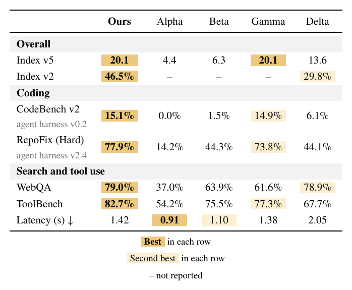

### Many methods on many benchmarks (a leaderboard)

*What the reader should see:* which method is best on each benchmark, and how
often that is yours.

- Mark the best value in each benchmark with the darkest fill and bold, the
  second with a lighter fill. Mark nothing when every value is equal.
- Tied values share a mark, and the next value takes the place after the tie
  (two values tied for best leave no second).
- Group benchmarks under section rows rather than with extra rules.
- Put the setting a number depends on (harness, version, prompt) in a small
  grey line under the benchmark name, not in a footnote.
- A missing value is a dash, in grey, so it does not read as zero.

Methods can run across (one column each, `by=row`) or down (one row each,
`by=column`, the default). Pick whichever fits the page: few methods and many
benchmarks fit across, many methods fit down.

### Your method against a baseline

*What the reader should see:* how much each method gains or loses relative to
a reference, and in which direction that is good.

- Show the change next to the value in small type, with its sign, in green
  when it helps and red when it hurts. "Helps" follows the direction of the
  measure: a lower error rate is green.
- Use absolute changes (points) when the measures share a scale, relative
  changes (percent of the baseline) when they do not.
- Rank on the values, not on the changes.

### Ablations

*What the reader should see:* which component matters, and how much.

- Show the full model once as absolute values and every variant as a change
  from it. The reader's question is the size and sign of each change, so
  that is what the table should hold.
- Leave out best and second marks; they answer a different question.

### A grid of values

*What the reader should see:* how a value moves along two factors at once
(size by data, layer by head).

- Shade every cell on one light-to-mid scale of the accent hue, darker is
  better. Keep the darkest step light enough that black text still reads.
- Shade across the whole table when the cells share a scale; shade per row or
  column when they do not.

### Mean and spread

Write `$74.0 \pm 0.4$` and say in the caption what the spread is (standard
deviation over seeds, a 95% interval). `pubviz` ranks on the mean.

## Figures

A figure is the right exhibit when the shape matters more than the exact
values: a trend, a gap that grows, a frontier.

Each kind below has a short script in [`examples/figures/`](../examples/figures)
that draws the image shown, from the data to the LaTeX that includes it with
its caption. The images were drawn for an IEEE column; the numbers are made
up.

### Which method wins, benchmark by benchmark (`bars`)

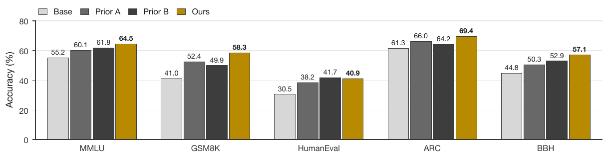

- Bars start at zero. If the interesting differences are small next to the
  values, show the differences instead (`deltas`).
- Ours in the accent; every other method in grey, light to dark. Keep the
  method order the same in every group and in the legend.
- Print the value on each bar; the reader quoting your result should not need
  to read it off the axis.
- More than about six methods or six groups is a table, not a figure.

Example: [`bars.py`](../examples/figures/bars.py). Caption: "**Ours scores
highest on four of five benchmarks.** Accuracy on each benchmark;
illustrative numbers." The legend names the colors, so the caption does not.

### How much each change helps or hurts (`deltas`)

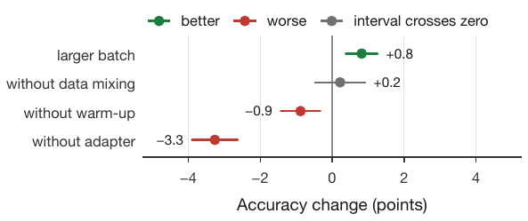

- One row per variant, a line at zero, the change as a dot with the interval
  of the change itself. Two overlapping intervals of the variants do not mean
  the change is uncertain; only the interval of the change says that.
- Green when the change helps, red when it hurts, grey when its interval
  crosses zero, which means the data cannot tell the sign. A key above the
  plot names each color beside its mark.
- Print the signed value beside each dot, so the figure reads without color.

Example: [`deltas.py`](../examples/figures/deltas.py), which takes the change
per seed and gets its interval with `mean_ci`. Caption: "**The adapter
matters most; data mixing does not clearly help.** Accuracy change against
the full model with 95% intervals of the change over five seeds."

### How a measure moves over time or steps (`curves`)

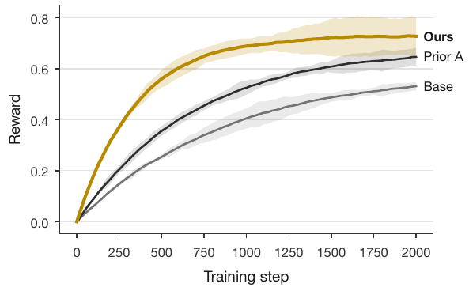

- Ours drawn last and thicker, in the accent; others in grey.
- Show the spread over seeds as a band and give the number of seeds in the
  caption. One run is one run; say "single seed".
- Name lines at their right end instead of in a legend.

Example: [`curves.py`](../examples/figures/curves.py). Caption: "**Ours
reaches the final reward of the best baseline in less than half the steps.**
Mean of three seeds with 95% intervals."

### What is gained on one axis and paid on another (`tradeoff`)

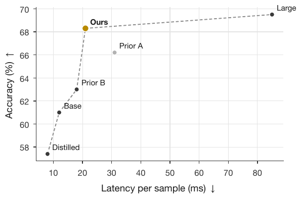

- One point per method, a dashed line through the methods no other method
  beats on both measures.
- Mark the better direction with an arrow on each axis label.
- Name points directly; ours in bold.

Example: [`tradeoff.py`](../examples/figures/tradeoff.py). Caption: "**Ours
moves the accuracy–latency frontier.** The dashed line joins methods that no
other method beats on both measures."

### Values over two factors (`heatmap`)

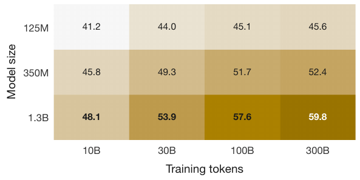

- The same scale and direction as the grid table, with ink switching to white
  only where the cell is dark.
- Bold the best value of each row or column when that is the point.

Example: [`heatmap.py`](../examples/figures/heatmap.py). Caption: "**Larger
models gain more from more data.** Accuracy (%) by model size and training
tokens; the best value of each column is bold."

### Every run, when there are only a few (`dots`)

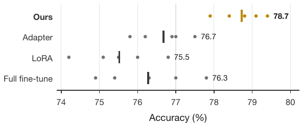

- One row per method, every run a dot, the mean a short bar with its value
  printed. With a handful of runs, a box plot or a density summarizes too
  little; the dots show everything, including the run far from the rest.
- Ours in the accent, every other method in one grey; the rows carry the
  names, so no legend is needed.
- Say in the caption how many runs there are and what varies between them
  (seeds, participants).

Example: [`dots.py`](../examples/figures/dots.py). Caption: "**Ours scores
higher on every seed.** Accuracy of each of five seeds; the bar and the
number are the mean."

### The level of each method, with the uncertainty of its mean (`means`)

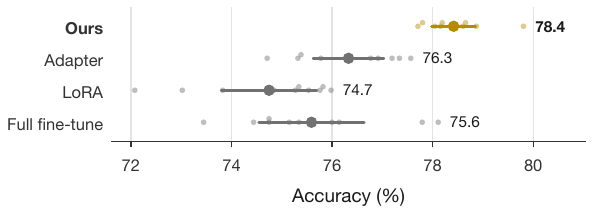

- A point at the mean and a line over its 95% interval. `show="gradient"`
  shades the row instead: full inside the interval, fading outside it.
- The runs are drawn faintly under the estimate whenever they are given.
  Readers shown only the interval of a mean, researchers among them,
  overstate how often one method beats another; with the runs beside it,
  their estimates come close to the truth (Hofman et al. 2020; Zhang et al.
  2023). `points=False` drops them.
- Not bars: with a bar, readers take values inside it as likelier than values
  above it.
- When the claim is the difference between two methods, draw the difference
  with `deltas`. Two intervals side by side do not show whether the
  difference is reliable.

Example: [`means.py`](../examples/figures/means.py), which draws both styles.
Caption: "**Ours has the highest mean accuracy.** Mean over ten seeds with its
95% interval."

### How many runs spread (`distributions`)

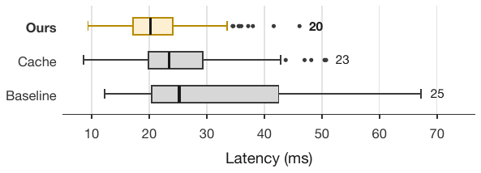

- Choose the kind by what the reader should judge; none is read best for
  everything (Lotteraner et al. 2026; Newburger et al. 2023). `kind="box"`
  for the median and for comparing methods; `"strip"` for the range and the
  spread; `"violin"` for the shape, such as two peaks a box hides;
  `"histogram"` for counts on bins shared by every row. `points=True` lays
  the runs over a box or violin. The median is printed at the end of each
  row.
- Say in the caption what the box, the whiskers and the dots mark.
- With fewer than about ten runs per method, `distributions` warns: draw every
  run with `dots` instead.

Example: [`distributions.py`](../examples/figures/distributions.py), which
draws all three. Caption: "**Ours is faster on most requests, with a shorter
tail.** Latency of 400 requests per method. Boxes span the middle half, the
line and number are the median, whiskers reach 1.5 box lengths and dots are
requests beyond them."

### Groups of methods or settings (`sections=`)

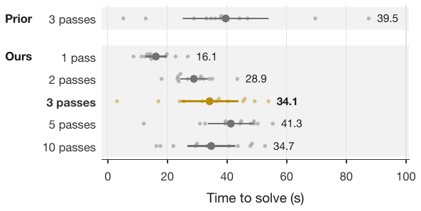

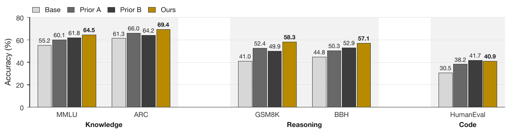

- When rows (or bars) belong to a higher level, such as the settings of one
  model or the variants of one ablated part, pass `sections={"Prior":
  [...], "Ours": [...]}`, or name each row as a (section, member) pair. The
  kinds with one row per item and `bars` take it.
- Each section gets a little space before it, its name beside its rows (or
  under its bars) in bold, and a light grey band behind it, with white
  between the bands. The three cues agree on purpose: an enclosing region is
  among the strongest grouping cues, beating spacing when the two conflict
  (Montoro & Luna 2015), and people rebuilt two-level structures best when
  every group was enclosed and no cue competed (Bae & Watson 2014). No study
  has tested bands in charts. `band="alternate"` shades every other section,
  like zebra rows; `band=None` keeps only the space and the names.
- Group only when the claim is about the groups. Grouping makes comparisons
  within a group easier and comparisons across groups harder (Nothelfer et
  al. 2017), and gaps between groups make the overall best less obvious
  (Fygenson et al. 2024).
- The band is the table's section shade, a neutral grey, never the accent,
  so it does not read as a mark of ours. It is lighter than the 10–15% tint
  publishers ask for in print (AMS; Cambridge), so a printer may drop it;
  the space and the names still carry the groups.
- Rows are sorted within their section where the kind sorts (`deltas`,
  `ranked`).

Example: the third figure of [`means.py`](../examples/figures/means.py) and
the second of [`bars.py`](../examples/figures/bars.py).

### One value per item, for many items (`ranked`)

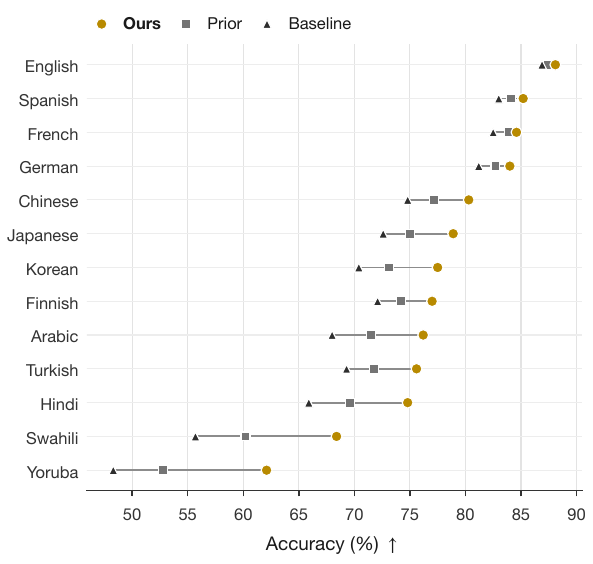

- For more items than bars can hold (languages, classes, tasks), and in
  place of a radar chart: values read from a common straight scale more
  accurately than from angles and spokes (Cleveland & McGill 1984; Fuchs et
  al. 2017).
- One row per item, sorted best first by ours (`sort="mean"` or `None` for
  another order); one dot per system, each with its own marker and shade,
  and a thin line from the lowest to the highest dot of the row.
- The axis need not start at zero: a dot is read by its position, not its
  length.

Example: [`ranked.py`](../examples/figures/ranked.py). Caption: "**Ours gains
most on the languages where the baselines are weakest.** Accuracy on each
language of the test set, sorted by ours."

### A measure against model size, data or compute (`scaling`)

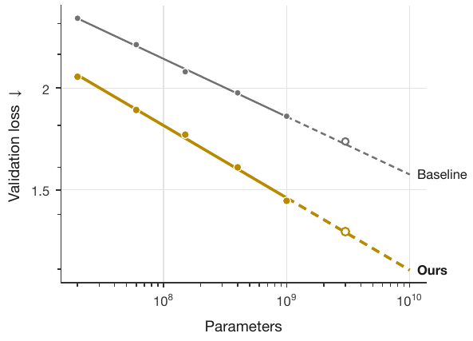

- Both axes logarithmic, a power law fitted per series. The line is solid
  over the points it was fitted on and dashed beyond them; points held out of
  the fit are hollow, so the reader sees how far the trend was checked.
- Say in the caption which points were fitted. Readers misread log–log
  axes more often than linear ones, experts included (Menge et al. 2018), so
  state the trend in words too, such as the fitted exponent `scaling`
  returns.

Example: [`scaling.py`](../examples/figures/scaling.py). Caption: "**Ours
falls faster with size.** Validation loss against parameters. Lines are power
laws fitted on the filled points; the hollow point was held out, and dashes
extend the fit beyond the data."

### How people rated each system (`ratings`)

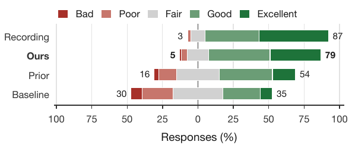

- Diverging stacked bars (Heiberger & Robbins 2014): answers below the middle
  of the scale to the left of zero, those above it to the right, so the share
  on each side reads from one baseline. The neutral answer is split across
  zero, or set aside with `neutral="aside"`, as for ties in win / tie / loss.
- The share on each side is printed at its end. Darker shades are stronger
  answers; side and position carry the same information, so the bars read in
  grey.
- Ratings are ordered categories. A mean alone hides how the answers spread
  and can even reverse an order (Liddell & Kruschke 2018). When the paper
  reports a mean opinion score, draw it with `means` from the tuple (mean,
  low, high), and give the number of votes and the standard deviation, as
  ITU-T P.800.2 asks.

Example: [`ratings.py`](../examples/figures/ratings.py), which also draws a
win / tie / loss figure. Caption: "**Listeners rated ours good or excellent
about as often as the recordings.** Answers on a five-point quality scale, 20
listeners by 30 sentences per system; the numbers are the shares below and
above Fair."

### Which classes are mixed up (`confusion`)

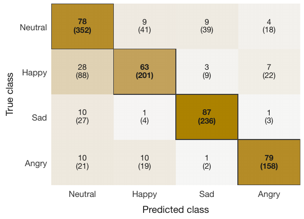

- One row per true class, one column per predicted class, with axis titles
  that say so: readers swap missed and false alarms when rows and columns
  look alike (Beauxis-Aussalet et al. 2019).
- Rows as shares of each class (`normalize="row"`), so rare and common
  classes compare; the diagonal is then each class's recall. The shading runs
  from 0 to 100% whatever the data. Up to six classes each cell prints the
  share over the count, since readers find counts easier than rates (same
  source); beyond six, the share alone. Empty cells show a dash.
- The diagonal is outlined and in bold.

Example: [`confusion.py`](../examples/figures/confusion.py). Caption:
"**Happy speech is most often taken for neutral.** Share of each true emotion
(rows) given each predicted label; the diagonal is each class's recall."

### How strongly items of two sequences attend to each other (`attention`)

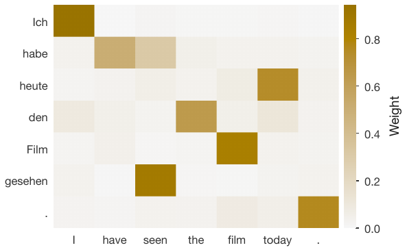

- One row per output item, one column per input item, darker for a larger
  weight, no numbers. Past `most` items only every few are named.
- Attention weights are not evidence of which inputs the output depends on:
  very different weights can give the same output (Jain & Wallace 2019), and
  in the upper layers of a Transformer they are close to uniform (Abnar &
  Zuidema 2020). Say in the caption which layer and heads the weights come
  from, and claim only what the pattern shows.

Example: [`attention.py`](../examples/figures/attention.py). Caption:
"**Cross-attention follows the word order except where German moves the
verb.** Weights of the last decoder layer, averaged over heads, for one test
sentence."

### How a classifier trades its errors (`roc`, `precision_recall`, `det`, `reliability`)

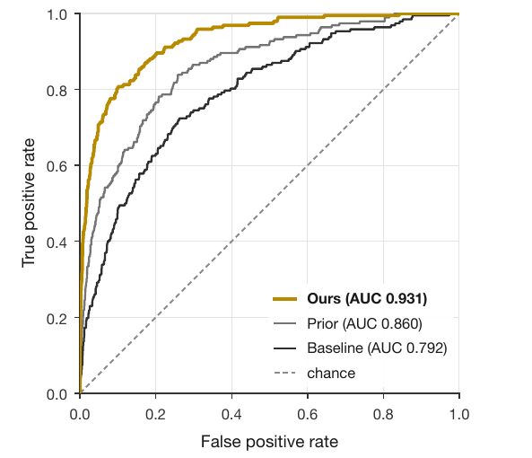

- Each takes, per method, the true labels and the scores, computes the curve
  and prints its summary beside the name; ours in the accent, the rest grey.
- `roc`: true against false positive rate, the dashed diagonal for guessing,
  equal axis scales. When positives are rare, a large area can hide many
  false positives among few true ones (Davis & Goadrich 2006; Saito &
  Rehmsmeier 2015): show `precision_recall` as well.
- `precision_recall`: drawn as steps, since joining the points with straight
  lines overstates precision (Davis & Goadrich 2006); the dashed line is the
  share of positives, the precision of guessing.
- `det`: miss against false alarm rate on normal-deviate scales, the
  convention of speaker verification (Martin et al. 1997), with the equal
  error rate marked.
- `reliability`: how often predictions were right against how sure they
  were, each point at its bin's mean prediction. The diagram alone hides how
  many cases each bin holds, and the bin count can change its look
  (Guo et al. 2017; Dimitriadis et al. 2021): pass `counts_ax` to show the
  counts under it.

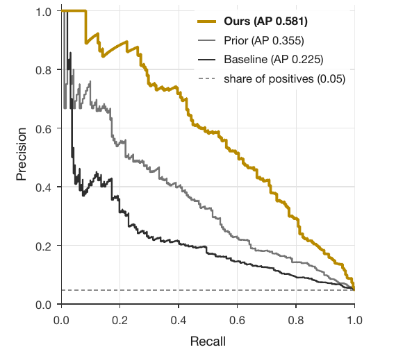

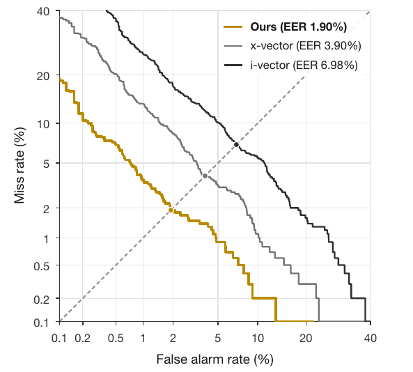

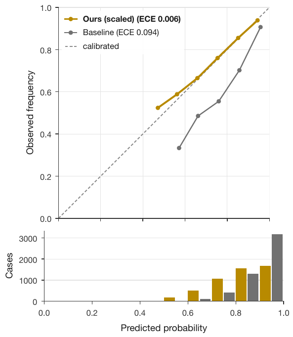

Examples: [`roc.py`](../examples/figures/roc.py),
[`precision_recall.py`](../examples/figures/precision_recall.py),
[`det.py`](../examples/figures/det.py) and
[`reliability.py`](../examples/figures/reliability.py). Caption for the PR
curves: "**With 5% positives, every method loses most of its precision before
it finds half of them.** Precision–recall curves on the test set; average
precision (AP) is in the legend, and the dashed line is the precision of
guessing."

### The same examples as each method gives them (`images`)

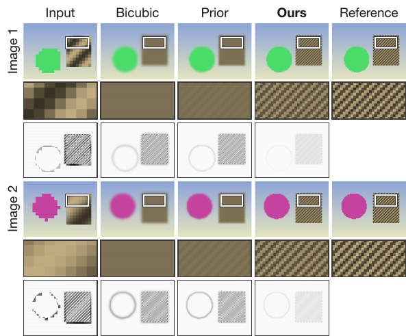

- One row per example, one column per method, every image the same size and
  scale, ours named in bold. `pv.images` builds the whole figure.
- `zoom=(x, y, width, height)` outlines one region on every image and shows
  it enlarged underneath, the same region for every method. Small
  differences in a large image go unseen without a cue to where they are
  (Rensink et al. 1997), and enlarged regions shown side by side made
  comparisons more accurate than outlines alone (Lekschas et al. 2020).
- `error="Reference"` adds a row with each output's absolute difference from
  the reference column, white for none and dark for large, on one scale per
  example. A difference image beside the pair helped radiologists find
  changes (Difazio et al. 1997).
- Say in the caption how the examples were chosen. Random examples give the
  least biased picture (van Miltenburg et al. 2021); examples picked because
  they look good mislead about the typical case.

Example: [`images.py`](../examples/figures/images.py). Caption: "**Ours keeps
the fine stripes that the others blur.** Two test images upscaled four
times; the boxed region is enlarged under each image, and the bottom row is
each output's difference from the reference."

### Which parts of an image a prediction rests on (`overlay`)

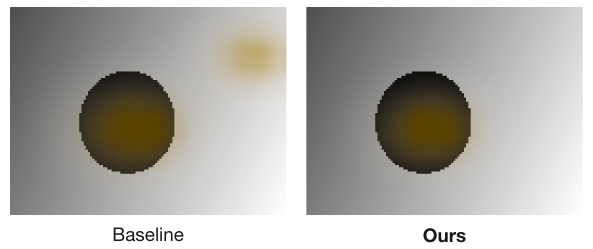

- The image in grey, so the only color on it is the map's; opacity grows with
  the weight, so small weights leave the image visible. A signed map uses two
  hues, since showing only the size of a signed map hides where its sign flips
  (Adebayo et al. 2018).
- Saliency maps convince readers of wrong predictions almost as often as of
  right ones (Kim et al. 2022), and some methods give the same map after the
  model's weights are randomized (Adebayo et al. 2018). Name the method and
  claim only what the map shows.

Example: [`overlay.py`](../examples/figures/overlay.py). Caption: "**Ours
weighs the object; the baseline also weighs the background.** Grad-CAM maps
on one test image, each scaled to its own maximum."

### A sound over time (`spectrogram`, `waveform`)

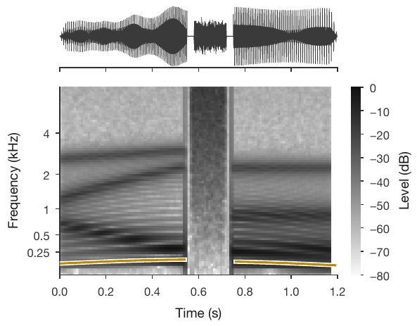

- Energy in dB relative to the loudest bin, down to a floor (−80 dB by
  default); keep one floor for spectrograms that are compared. White is quiet
  and near black is loud, in even lightness steps, so the plot prints in grey
  unchanged; a rainbow scale would invent bands.
- `mel=80` for mel bands, labelled in kHz. `level=` draws a computed
  spectrogram, such as a model's predicted mel spectrogram.
- `f0=` lays the pitch contour on top in the accent; `waveform` draws the
  signal above it on the same time axis.

Example: [`spectrogram.py`](../examples/figures/spectrogram.py). Caption:
"**The pitch contour follows the rise and fall of the phrase.** Waveform
(top) and 80-band mel spectrogram (bottom; dB relative to the loudest bin,
down to −80 dB) with the estimated F0."

### Where a model puts its inputs (`embedding`)

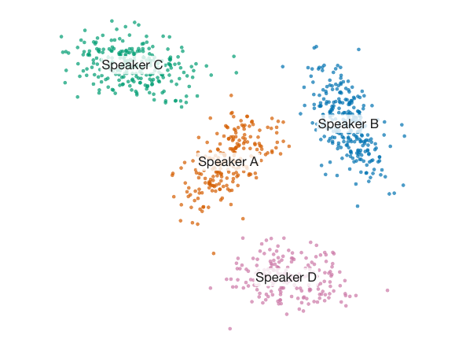

- A 2-D map of points colored by class, each class named on the map, no
  ticks, equal axis scales. Past the colors that can be told apart, the
  smallest classes are folded into a grey "Other": in scatterplots, accuracy
  fell as categories were added, above all from six on (Tseng et al. 2023).
- In t-SNE and UMAP maps, cluster sizes and the distances between clusters
  carry no meaning (Wattenberg et al. 2016; Kobak & Berens 2019); readers find
  clusters well but judge which is nearest or densest poorly (Xia et al.
  2022). Say so in the caption.

Example: [`embedding.py`](../examples/figures/embedding.py). Caption:
"**Utterances of the same speaker group together.** t-SNE map of 1,000
speaker embeddings. Distances between groups and their sizes carry no
meaning in this map."

### Weights over the words of a sentence (`\pvshade`)

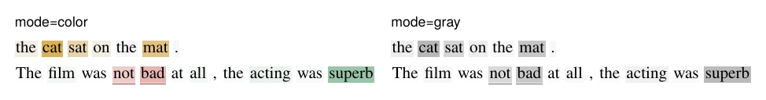

- `\pvshade{t}{word}` sets a word on a shade of the accent scale, t from 0
  to 1; `\pvshade*{t}{word}` takes t from −1 to 1, a tint of `pos` or `neg`,
  with a line under negative words so the sign survives a grey print. The
  text stays text, in the paper's font and script.
- `pv.pvshade(tokens, weights)` writes the LaTeX for a whole sentence, scaled
  to its largest weight (or to `scale=`), escaping special characters;
  `join=""` for Chinese or Japanese.
- Readers judge a shaded word as more important when it is longer (up to
  about eight letters) and read very pale shades as none (Schuff et al.
  2022). Compare shades within a sentence, and say in the caption what the
  weights are.

## Diagrams

A diagram shows what the method is: the steps it takes, or the parts it is
made of. TikZ draws them inside the paper, so they share the paper's colors,
print mode and text, and come out at the printed size.

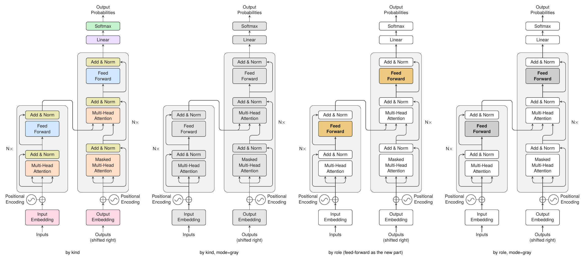

### Steps in order (a pipeline)

*What the reader should see:* what goes in, what comes out, the order of the
steps, and which step is new.

- Left to right, in reading order. Past about five steps, group them into
  stages (a group box with a title) or break the row in two.
- A box is a step. Plain text at the two ends names what goes in and what
  comes out.
- Solid arrows for the main flow. A path taken only in training, or a signal
  that goes back (a gradient, a reward), is dashed, and the key or caption
  says what dashed means.
- Number the steps when the text refers to them ("step 3 filters ...").

### Parts of a model (an architecture)

*What the reader should see:* the parts, how data flows through them, and
what the paper adds or changes.

- Inside one stack, bottom to top, with the input at the bottom, as in most
  model figures. Between modules (an encoder and a decoder), left to right.
- A box is a layer, a small circle is an operation (⊕ for add), and a group
  box marked "N×" is a layer repeated N times.
- Residual paths run around the side, into the block where they are added.
- Write a tensor shape beside an edge, in small grey text, where it helps the
  reader follow the data.
- When one block is the contribution, show the whole model and, beside it, a
  larger copy of that block with its insides.

### Filling blocks: by role or by kind

- **By role** (the default): every block white, and only the part the paper
  adds filled with the accent, its label in bold. Use it when the point is a
  change to a known model; the reader finds the change at a glance.
- **By kind** (`pv kinds`): one light fill per kind of layer, all at one
  lightness, so black text reads on every fill and a grey print loses nothing
  the labels do not say. Use it when the point is the structure itself, as
  when the whole model is new. A part the paper adds keeps its kind fill and
  gets a thick accent border.
- Same kind, same fill, in every diagram of the paper.

### A lighter style for stages and flows

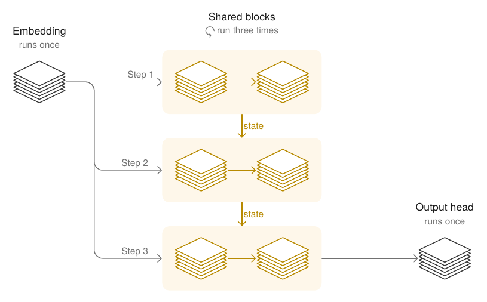

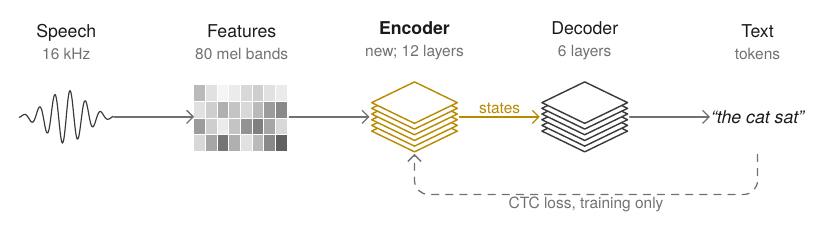

- For a model drawn as stages rather than as every layer, and for
  pipelines. A stack of layers is a small picture (`pv stack`, `pv
  layers=n`), not a labelled box; the stage's name is a title above it
  (`pv title`) with a grey note under it (`\pvnote{runs once}`). Put the
  titles of one row on one line.
- Flows are thin grey links with open arrowheads (`pv link`). A branching
  line is drawn whole from its start for each branch, so every turn is
  rounded. A path used only in training is dashed.
- Parts that belong together, such as blocks that repeat, sit in a light
  region with no border (`pv region`); the part the paper adds sits in an
  accent region (`pv region=pv-fill-3`), and its stacks, edges and labels
  take the accent (`pv emph`). In grey and plain print the accent's grey
  would be lighter than the rest, so `pv emph` turns near black with a
  heavier line there, and plain print gives regions a dotted border.
- `\pvrepeat` draws a loop sign for a part that runs more than once.
- Keep a title on every picture. Text labels were read with fewer errors
  than pictures standing in for them (Haroz et al. 2015), and readers of
  neural network diagrams disagree on whether a drawn count is meant: some
  take four drawn layers to mean four (Marshall et al. 2025). The layers a
  stack shows are a picture, not a count; give the real count in the note.
- Keep each region in one piece, with titles outside it: unbroken group
  regions did not slow readers tracing paths (Saket et al. 2014), while
  fragmented regions with labels on top did (Jianu et al. 2014). Run the
  flow left to right, the reading order that worked best for flowcharts
  (Krohn 1983). No study has tested rounded corners, open arrowheads or
  boxes without borders; they are our choice for a lighter page.

Examples: [`looped.tex`](../examples/diagrams/looped.tex),
[`asr.tex`](../examples/diagrams/asr.tex) and
[`retrieval.tex`](../examples/diagrams/retrieval.tex).

### Size

Draw at the printed size. `pvdiagram` warns when a diagram is wider than its
column: shorten labels, move blocks closer, or stack the layout. Never scale
a diagram down; its text shrinks with it, below the caption's size.

## Figure text and size

Figure text is set from the body font size of the venue: axis labels about
two points smaller than the body, tick labels and legends about three
smaller, values on bars about four smaller and never below 5 pt. The default
face is a plain sans serif, which stays readable at those sizes; choose the
body face instead (`font="body"`) when a figure carries a lot of math. The
width is the venue's column width, or its text width for a figure that spans
both columns. The kinds with one row per item (`deltas`, `dots`, `means`,
`distributions`, `ranked`, `ratings`, `confusion`) make the figure taller
when its rows would not fit at the venue's text size, so no two row names
touch; the width never changes. A legend that wraps still reads left to
right, row by row.
